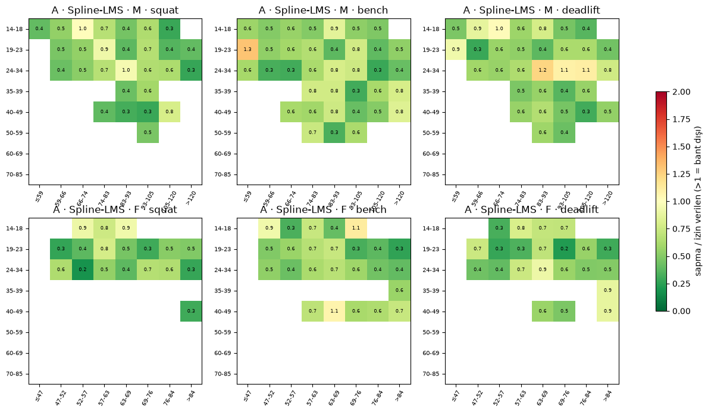
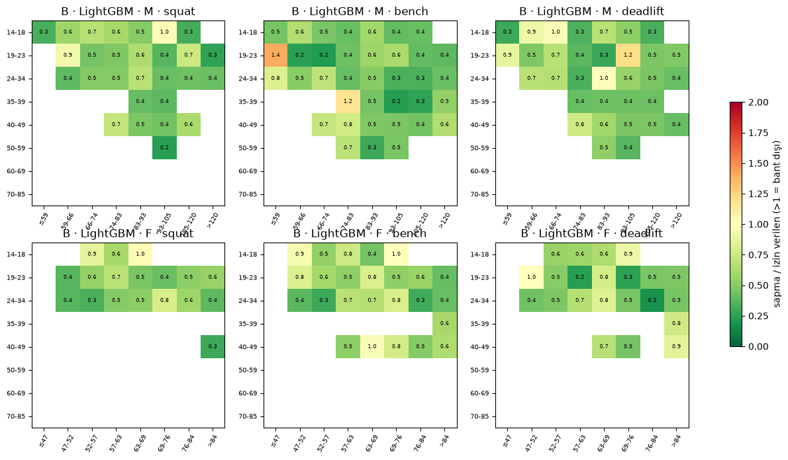
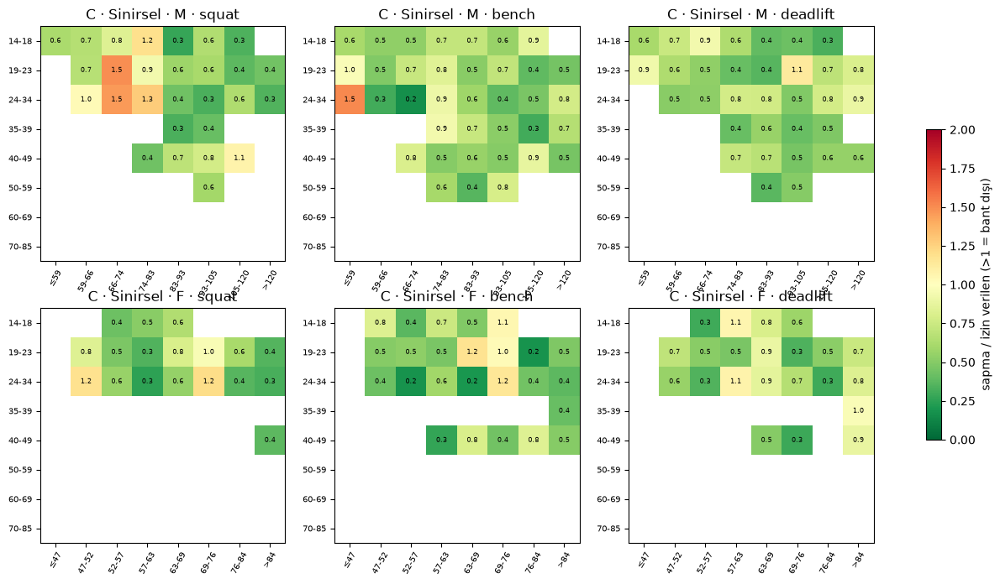

# Model yarışması (P053)

Bu dosyanın ilk iki bölümü **deneylere başlamadan önce** yazıldı ve commit edildi (ön kayıt). Sonuçlar §3'ten
itibaren `make tune` / `make bakeoff` çıktısıyla eklenir.

## 1. Seçim kriterleri (docs/03-ML-MODEL.md §4.3, birebir kopya)

Kazanan, sonuçlar görülmeden önce yazılmış şu kurallarla seçilir:

1. **Birincil metrik:** Test kümesinde ortalama pinball kaybı (CRPS yaklaşımı), 19 çeyrek üzerinden.
2. **Kalibrasyon kapısı:** Her katmanda (cinsiyet × yaş bandı × kilo bandı, n ≥ 500) PIT histogramı tekdüze olmalı;
   10–90 arası çeyreklerde gözlenen-beklenen kapsama farkı ≤ `max(2 yüzdelik puan, katman gürültü bandı)`.
   Gürültü bandı = 2.77 · √(0.25 / n_etkin) · 100 (9 çeyrekte Bonferroni ile katman başına %95; n_etkin Kish etkin
   örneklemi). Kusursuz bir model de katmanların ~%5'inde bandı rastlantıyla aşacağından kapı, bandı aşan katman
   oranı ≤ %10 ise geçilmiş sayılır. *(2026-11-13 kullanıcı onayı: n≈500 ağırlıklı katmanlarda yalnız örnekleme
   gürültüsü 5–8 puan olduğundan düz 2 puan sınırı karşılanamıyordu; bkz. `ml/reports/baselines.md`.)*
   Kilo bantları yarışma kilo sınıflarıdır (erkek ≤59/66/74/83/93/105/120/>120, kadın ≤47/52/57/63/69/76/84/>84 kg).
   *(2026-11-13 kullanıcı onayı: yarışma verisinde güç sınıf sınırının hemen altında tepe yapıp hemen üstünde ~%7
   düşüyor; 10 kg'lık ondalık bantlar bu dişleri böldüğünden pürüzsüz modelleri haksız yere eliyordu.)*
3. **Akıl sağlığı testleri (hepsi geçmeli):**
   - Skor, kaldırılan ağırlıkta kesin artan.
   - Aynı kaldırış için skor, vücut ağırlığı arttıkça **artmamalı** (daha ağır kişi için aynı yük daha az etkileyicidir).
   - Beklenen medyan yaşla tek tepeli olmalı, tepe 20–40 yaş arasında; ani sıçrama olmamalı. *(2026-11-13 kullanıcı
     onayı: OPL ham verisinde tepe 27–34, bench'te 32–41 yaş; "20'lerin ortası" ifadesi bu aralıkla değiştirildi.)*
     "Ani sıçrama" sınırı (ardışık yaşlar arasında medyanda ≤ %4 değişim) yalnızca 20 yaş ve üstüne uygulanır;
     gençlerde yıllık artış verinin kendisinde %4–10 olduğundan oradaki kırılmaları pürüzsüzlük (ikinci fark)
     testi denetler. *(2026-11-13 kullanıcı onayı, P053 deneylerinden önce.)*
   - van den Hoek 2024 tablolarındaki 90. yüzdelik değerlerine ±%3 içinde uyum. vdH her yarışma kaydını ayrı sayar,
     modeller sporcu başına eşit ağırlıkla eğitilir; bu yüzden P053 bu ölçütü ağırlıklandırma açık ve kapalı iki
     sürümle raporlar ve karşılaştırmayı ağırlıksız sürüm üzerinden yapar. *(2026-11-13 kullanıcı onayı.)*
4. **Dağıtım kısıtı:** Model < 1 MB, tek çıkarım < 1 ms.
5. **Eşitlik durumunda** (birincil metrik farkı < %1) daha basit model kazanır (A > C > B).

## 2. Deney protokolü (ön kayıt)

- **Veri:** P048 kohortu, referans `tested = true`, `wraps = false`, ters-frekans ağırlıklar; P049 bölmesi
  (sporcu bazlı %70/15/15, tohum 20260101). Arama ve tohum tekrarları yalnızca **doğrulama** kümesinde.
- **Arama:** Optuna TPE (örnekleyici tohumu 20260101), aday başına **aynı bütçe: 10 deneme**, her deneme üç
  kaldırışı eğitir. Amaç: üç kaldırışın doğrulama pinball ortalaması (kg). Kalibrasyon kapısını (§1 madde 2)
  herhangi bir kaldırışta ihlal eden deneme budanır; B için 1 MB'ı aşan deneme de budanır (madde 4). Bir adayın
  bütün denemeleri budanırsa en düşük pinball'lu denemesi "kapıyı geçemedi" notuyla raporlanır.
- **Arama uzayları:**
  - A (Spline-LMS): aile {BCCG, BCPE}, yaş düğüm aralığı 6–16, kilo düğüm aralığı 5–12, μ cezası 1e-4–1e-1,
    σ cezası 1e-3–1, ν ve τ cezası 1e-2–10 (log ölçek; yaş ve kilo yönünde aynı katsayı).
  - B (LightGBM): ağaç sayısı 50–400, yaprak 4–31, öğrenme oranı 0.03–0.3, yaprakta en az örnek 100–2000,
    monotonluk kısıtı {açık, kapalı}.
  - C (sinirsel): genişlik {32, 48, 64, 96}, derinlik {2, 3}, aktivasyon {silu, tanh}, ağırlık azaltma
    1e-6–1e-2, öğrenme oranı 1e-3–1e-2, başlık {bcpe, shash}.
- **Tohum tekrarı:** her adayın en iyi yapılandırması 3 tohumla (1, 2, 3) yeniden eğitilir; doğrulama
  metrikleri ortalama ± standart sapma.
- **Test kümesi:** her aday için tek nihai yapılandırma, 3 tohum modeli test kümesinde **bir kez** ölçülür
  (kod bir kilit dosyasıyla ikinci bakışı reddeder). Seçim §1'e göre test sonuçlarıyla yapılır.
- **Duyarlılık (doğrulama, tohum 1):** Tested=Yes yerine tüm veri; squat'ta wraps dahil; ağırlıklandırma kapalı.
  vdH ±%3 ölçütü kullanıcı onayı gereği ağırlıklandırması kapalı sürümle karşılaştırılır.
- **Ön kayıt değişikliği (2026-11-13):** ilk arama koşumu A ve C'nin bütün denemelerini 10 kg'lık bantlarda
  budadı; kök neden kilo sınıfı dişiydi. Kullanıcı onayıyla katmanlar kilo sınıflarına çevrildi ve arama
  **sıfırdan** yeniden başlatıldı; ilk koşumun sonuçları seçimde kullanılmadı ve test kümesine bakılmadı.
- **Akıl sağlığı testleri** (`gymml.eval.sanity`) nihai modellerde; yaş sıçrama sınırı 20+ yaş (onay
  2026-11-13, deneylerden önce).

## 3. Arama sonuçları

Aday başına 10 deneme (doğrulama kümesi, tohum 1).

### A · Spline-LMS

| deneme | pinball_ort | kapı | boyut_KB | budandı | süre_dk | yapılandırma |
|---|---|---|---|---|---|---|
| 0 | 8.091 | ❌ | 23.97 | ✅ | 2.483 | {"family": "BCCG", "age_segments": 10, "bw_segments": 7, "pen_mu": 0.001968491547597536, "pen_sigma": 0.008938149825747123, "pen_shape": 0.6126092699404004} |
| 1 | 8.079 | ❌ | 50.59 | ✅ | 5.655 | {"family": "BCPE", "age_segments": 14, "bw_segments": 11, "pen_mu": 0.0005983586353246859, "pen_sigma": 0.12777775483924037, "pen_shape": 0.02967518900653364} |
| 2 | 8.108 | ❌ | 22.68 | ✅ | 2.662 | {"family": "BCCG", "age_segments": 10, "bw_segments": 6, "pen_mu": 0.004472607410566659, "pen_sigma": 0.02488452612353382, "pen_shape": 0.031598464895711574} |
| 3 | 8.085 | ❌ | 28.75 | ✅ | 2.884 | {"family": "BCCG", "age_segments": 15, "bw_segments": 6, "pen_mu": 0.0013474175068580972, "pen_sigma": 0.06095949428646764, "pen_shape": 0.37826137323925163} |
| 4 | 8.103 | ❌ | 35.28 | ✅ | 3.758 | {"family": "BCCG", "age_segments": 14, "bw_segments": 9, "pen_mu": 0.012720465514169627, "pen_sigma": 0.1108988372420689, "pen_shape": 2.057624155201481} |
| 5 | 8.158 | ❌ | 32.41 | ✅ | 8.386 | {"family": "BCPE", "age_segments": 6, "bw_segments": 11, "pen_mu": 0.0025760769182410115, "pen_sigma": 0.6109133710361357, "pen_shape": 9.26721178837071} |
| 6 | 8.097 | ❌ | 28.58 | ✅ | 6.766 | {"family": "BCPE", "age_segments": 9, "bw_segments": 6, "pen_mu": 0.0022590468323773955, "pen_sigma": 0.003638537018212911, "pen_shape": 9.423146830493673} |
| 7 | 8.09 | ❌ | 34.5 | ✅ | 5.997 | {"family": "BCPE", "age_segments": 9, "bw_segments": 9, "pen_mu": 0.00022416184838768176, "pen_sigma": 0.2931772341735375, "pen_shape": 1.9357203608013123} |
| 8 | 8.09 | ❌ | 37.5 | ✅ | 3.586 | {"family": "BCCG", "age_segments": 14, "bw_segments": 10, "pen_mu": 0.011166919594742763, "pen_sigma": 0.001253943991057336, "pen_shape": 0.2681539481607437} |
| 9 | 8.07 | ✅ | 55.06 | ❌ | 8.498 | {"family": "BCPE", "age_segments": 14, "bw_segments": 12, "pen_mu": 0.0003273089540229314, "pen_sigma": 0.005544482203665084, "pen_shape": 0.1262493057814864} |

Seçilen: deneme 9 `{"family": "BCPE", "age_segments": 14, "bw_segments": 12, "pen_mu": 0.0003273089540229314, "pen_sigma": 0.005544482203665084, "pen_shape": 0.1262493057814864}`.

### B · LightGBM

| deneme | pinball_ort | kapı | boyut_KB | budandı | süre_dk | yapılandırma |
|---|---|---|---|---|---|---|
| 0 | 8.07 | ❌ | 2.754e+04 | ✅ | 4.091 | {"num_rounds": 289, "num_leaves": 14, "learning_rate": 0.07717690657976162, "min_data_in_leaf": 258, "monotone": true} |
| 1 | 8.042 | ❌ | 2.156e+04 | ✅ | 3.674 | {"num_rounds": 259, "num_leaves": 12, "learning_rate": 0.13235639095798277, "min_data_in_leaf": 996, "monotone": true} |
| 2 | 8.038 | ❌ | 1.729e+04 | ✅ | 2.972 | {"num_rounds": 296, "num_leaves": 8, "learning_rate": 0.2879408074680272, "min_data_in_leaf": 132, "monotone": true} |
| 3 | 8.189 | ❌ | 2.761e+04 | ✅ | 3.579 | {"num_rounds": 243, "num_leaves": 17, "learning_rate": 0.04402269064127615, "min_data_in_leaf": 619, "monotone": false} |
| 4 | 8.127 | ❌ | 1.222e+04 | ✅ | 1.726 | {"num_rounds": 128, "num_leaves": 14, "learning_rate": 0.11806877025806892, "min_data_in_leaf": 482, "monotone": true} |
| 5 | 8.031 | ✅ | 4.264e+04 | ✅ | 5.628 | {"num_rounds": 336, "num_leaves": 19, "learning_rate": 0.15087672772959076, "min_data_in_leaf": 770, "monotone": true} |
| 6 | 7.993 | ✅ | 1.758e+04 | ✅ | 2.879 | {"num_rounds": 383, "num_leaves": 6, "learning_rate": 0.1844054618187431, "min_data_in_leaf": 408, "monotone": false} |
| 7 | 8.25 | ❌ | 2.869e+04 | ✅ | 2.689 | {"num_rounds": 170, "num_leaves": 26, "learning_rate": 0.05673340667047651, "min_data_in_leaf": 201, "monotone": true} |
| 8 | 8.032 | ❌ | 5.279e+04 | ✅ | 5.918 | {"num_rounds": 397, "num_leaves": 20, "learning_rate": 0.21174078542803842, "min_data_in_leaf": 275, "monotone": true} |
| 9 | 8.03 | ✅ | 5.535e+04 | ✅ | 5.956 | {"num_rounds": 338, "num_leaves": 25, "learning_rate": 0.14595714257821696, "min_data_in_leaf": 216, "monotone": true} |

Seçilen: deneme 6 `{"num_rounds": 383, "num_leaves": 6, "learning_rate": 0.1844054618187431, "min_data_in_leaf": 408, "monotone": false}`. **Bütün denemeler budandı**; en düşük pinball'lu deneme kullanıldı.

### C · Sinirsel

| deneme | pinball_ort | kapı | boyut_KB | budandı | süre_dk | yapılandırma |
|---|---|---|---|---|---|---|
| 0 | 8.105 | ❌ | 6.559 | ✅ | 0.5148 | {"width": 32, "depth": 2, "activation": "tanh", "weight_decay": 1.3920590285431507e-05, "lr": 0.004411879698599427, "head": "shash"} |
| 1 | 8.099 | ❌ | 43.56 | ✅ | 0.9962 | {"width": 96, "depth": 2, "activation": "silu", "weight_decay": 0.00015876241823976358, "lr": 0.0029195088200660944, "head": "shash"} |
| 2 | 8.083 | ❌ | 22 | ✅ | 0.5922 | {"width": 48, "depth": 3, "activation": "tanh", "weight_decay": 7.198618222531042e-06, "lr": 0.006543429388435405, "head": "shash"} |
| 3 | 8.089 | ❌ | 43.56 | ✅ | 1.036 | {"width": 96, "depth": 2, "activation": "silu", "weight_decay": 0.005183695800266344, "lr": 0.009749515395899484, "head": "shash"} |
| 4 | 8.086 | ❌ | 37.31 | ✅ | 0.8425 | {"width": 64, "depth": 3, "activation": "tanh", "weight_decay": 2.25430169734097e-05, "lr": 0.003280805030725972, "head": "shash"} |
| 5 | 8.094 | ❌ | 10.68 | ✅ | 1.774 | {"width": 32, "depth": 3, "activation": "silu", "weight_decay": 8.026242200506774e-05, "lr": 0.0010198368779420132, "head": "bcpe"} |
| 6 | 8.095 | ❌ | 6.559 | ✅ | 0.6731 | {"width": 32, "depth": 2, "activation": "tanh", "weight_decay": 1.2709861832954976e-06, "lr": 0.0026564972435528613, "head": "shash"} |
| 7 | 8.092 | ❌ | 79.93 | ✅ | 0.9104 | {"width": 96, "depth": 3, "activation": "tanh", "weight_decay": 3.278449757788477e-05, "lr": 0.003590808117521522, "head": "shash"} |
| 8 | 8.091 | ❌ | 43.56 | ✅ | 0.6001 | {"width": 96, "depth": 2, "activation": "tanh", "weight_decay": 1.5008469239121875e-06, "lr": 0.0042522725435618185, "head": "shash"} |
| 9 | 8.077 | ❌ | 37.31 | ✅ | 1.007 | {"width": 64, "depth": 3, "activation": "tanh", "weight_decay": 2.061865689886956e-06, "lr": 0.0031019454218951087, "head": "bcpe"} |

Seçilen: deneme 9 `{"width": 64, "depth": 3, "activation": "tanh", "weight_decay": 2.061865689886956e-06, "lr": 0.0031019454218951087, "head": "bcpe"}`. **Bütün denemeler budandı**; en düşük pinball'lu deneme kullanıldı.

## 4. Tohum tekrarı (doğrulama, 3 tohum, ortalama ± sd)

### A · Spline-LMS

| lift | tohum | pinball_kg | crps_kg | pit_ks | bant_dışı_oran | kapı_geçen_tohum |
|---|---|---|---|---|---|---|
| squat | 3 | 9.125 ± 0.001 | 18.250 ± 0.001 | 0.007 ± 0.000 | 0.029 ± 0.013 | 3/3 |
| bench | 3 | 6.033 ± 0.001 | 12.067 ± 0.001 | 0.006 ± 0.000 | 0.048 ± 0.000 | 3/3 |
| deadlift | 3 | 9.051 ± 0.000 | 18.103 ± 0.000 | 0.009 ± 0.000 | 0.045 ± 0.029 | 3/3 |
### B · LightGBM

| lift | tohum | pinball_kg | crps_kg | pit_ks | bant_dışı_oran | kapı_geçen_tohum |
|---|---|---|---|---|---|---|
| squat | 3 | 9.019 ± 0.001 | 18.038 ± 0.003 | 0.007 ± 0.000 | 0.000 ± 0.000 | 3/3 |
| bench | 3 | 5.991 ± 0.000 | 11.982 ± 0.000 | 0.006 ± 0.000 | 0.065 ± 0.000 | 3/3 |
| deadlift | 3 | 8.967 ± 0.000 | 17.933 ± 0.000 | 0.007 ± 0.000 | 0.032 ± 0.022 | 3/3 |
### C · Sinirsel

| lift | tohum | pinball_kg | crps_kg | pit_ks | bant_dışı_oran | kapı_geçen_tohum |
|---|---|---|---|---|---|---|
| squat | 3 | 9.132 ± 0.004 | 18.264 ± 0.008 | 0.011 ± 0.006 | 0.130 ± 0.109 | 1/3 |
| bench | 3 | 6.039 ± 0.002 | 12.077 ± 0.003 | 0.007 ± 0.001 | 0.134 ± 0.025 | 0/3 |
| deadlift | 3 | 9.059 ± 0.003 | 18.119 ± 0.007 | 0.009 ± 0.002 | 0.141 ± 0.040 | 1/3 |

## 5. Akıl sağlığı testleri (doğrulama, tohum 1)

| aday | lift | test | sonuç | ayrıntı |
|---|---|---|---|---|
| A · Spline-LMS | squat | skor yükte kesin artan (Q05–Q95 arası, 2.5 kg adım) | ✅ | en küçük CDF artışı 5.07e-03 |
| A · Spline-LMS | squat | aynı yükte skor kiloyla artmıyor | ✅ | kilo +1 kg'da en büyük CDF artışı 0.0015 (tolerans 0.005) |
| A · Spline-LMS | squat | yaş eğrisi tek tepeli, tepe 20–40, 20+ yaşta sıçrama yok | ✅ | tepe yaşı M/F [23.0, 23.0], 20+ yaşta en büyük yıllık değişim 0.038, tek tepeli=True |
| A · Spline-LMS | squat | pürüzsüzlük (ikinci fark sınırı) | ❌ | en büyük |Δ²medyan|/medyan 0.0123 (sınır 0.01) |
| A · Spline-LMS | squat | eğitim aralığı dışında makul davranış | ✅ | sonlu, pozitif, sıralı, fiziksel sınır içinde |
| A · Spline-LMS | bench | skor yükte kesin artan (Q05–Q95 arası, 2.5 kg adım) | ✅ | en küçük CDF artışı 7.54e-03 |
| A · Spline-LMS | bench | aynı yükte skor kiloyla artmıyor | ❌ | kilo +1 kg'da en büyük CDF artışı 0.0050 (tolerans 0.005) |
| A · Spline-LMS | bench | yaş eğrisi tek tepeli, tepe 20–40, 20+ yaşta sıçrama yok | ✅ | tepe yaşı M/F [31.0, 23.0], 20+ yaşta en büyük yıllık değişim 0.020, tek tepeli=True |
| A · Spline-LMS | bench | pürüzsüzlük (ikinci fark sınırı) | ❌ | en büyük |Δ²medyan|/medyan 0.0114 (sınır 0.01) |
| A · Spline-LMS | bench | eğitim aralığı dışında makul davranış | ✅ | sonlu, pozitif, sıralı, fiziksel sınır içinde |
| A · Spline-LMS | deadlift | skor yükte kesin artan (Q05–Q95 arası, 2.5 kg adım) | ✅ | en küçük CDF artışı 5.31e-03 |
| A · Spline-LMS | deadlift | aynı yükte skor kiloyla artmıyor | ✅ | kilo +1 kg'da en büyük CDF artışı 0.0029 (tolerans 0.005) |
| A · Spline-LMS | deadlift | yaş eğrisi tek tepeli, tepe 20–40, 20+ yaşta sıçrama yok | ✅ | tepe yaşı M/F [23.0, 24.0], 20+ yaşta en büyük yıllık değişim 0.029, tek tepeli=True |
| A · Spline-LMS | deadlift | pürüzsüzlük (ikinci fark sınırı) | ❌ | en büyük |Δ²medyan|/medyan 0.0114 (sınır 0.01) |
| A · Spline-LMS | deadlift | eğitim aralığı dışında makul davranış | ✅ | sonlu, pozitif, sıralı, fiziksel sınır içinde |
| B · LightGBM | squat | skor yükte kesin artan (Q05–Q95 arası, 2.5 kg adım) | ✅ | en küçük CDF artışı 4.37e-03 |
| B · LightGBM | squat | aynı yükte skor kiloyla artmıyor | ❌ | kilo +1 kg'da en büyük CDF artışı 0.1481 (tolerans 0.005) |
| B · LightGBM | squat | yaş eğrisi tek tepeli, tepe 20–40, 20+ yaşta sıçrama yok | ❌ | tepe yaşı M/F [26.0, 24.0], 20+ yaşta en büyük yıllık değişim 0.106, tek tepeli=False |
| B · LightGBM | squat | pürüzsüzlük (ikinci fark sınırı) | ❌ | en büyük |Δ²medyan|/medyan 0.1260 (sınır 0.01) |
| B · LightGBM | squat | eğitim aralığı dışında makul davranış | ✅ | sonlu, pozitif, sıralı, fiziksel sınır içinde |
| B · LightGBM | bench | skor yükte kesin artan (Q05–Q95 arası, 2.5 kg adım) | ✅ | en küçük CDF artışı 5.59e-03 |
| B · LightGBM | bench | aynı yükte skor kiloyla artmıyor | ❌ | kilo +1 kg'da en büyük CDF artışı 0.1176 (tolerans 0.005) |
| B · LightGBM | bench | yaş eğrisi tek tepeli, tepe 20–40, 20+ yaşta sıçrama yok | ❌ | tepe yaşı M/F [31.0, 23.0], 20+ yaşta en büyük yıllık değişim 0.099, tek tepeli=False |
| B · LightGBM | bench | pürüzsüzlük (ikinci fark sınırı) | ❌ | en büyük |Δ²medyan|/medyan 0.1163 (sınır 0.01) |
| B · LightGBM | bench | eğitim aralığı dışında makul davranış | ✅ | sonlu, pozitif, sıralı, fiziksel sınır içinde |
| B · LightGBM | deadlift | skor yükte kesin artan (Q05–Q95 arası, 2.5 kg adım) | ✅ | en küçük CDF artışı 3.83e-03 |
| B · LightGBM | deadlift | aynı yükte skor kiloyla artmıyor | ❌ | kilo +1 kg'da en büyük CDF artışı 0.1253 (tolerans 0.005) |
| B · LightGBM | deadlift | yaş eğrisi tek tepeli, tepe 20–40, 20+ yaşta sıçrama yok | ❌ | tepe yaşı M/F [22.0, 23.0], 20+ yaşta en büyük yıllık değişim 0.052, tek tepeli=False |
| B · LightGBM | deadlift | pürüzsüzlük (ikinci fark sınırı) | ❌ | en büyük |Δ²medyan|/medyan 0.0998 (sınır 0.01) |
| B · LightGBM | deadlift | eğitim aralığı dışında makul davranış | ✅ | sonlu, pozitif, sıralı, fiziksel sınır içinde |
| C · Sinirsel | squat | skor yükte kesin artan (Q05–Q95 arası, 2.5 kg adım) | ✅ | en küçük CDF artışı 4.99e-03 |
| C · Sinirsel | squat | aynı yükte skor kiloyla artmıyor | ✅ | kilo +1 kg'da en büyük CDF artışı -0.0000 (tolerans 0.005) |
| C · Sinirsel | squat | yaş eğrisi tek tepeli, tepe 20–40, 20+ yaşta sıçrama yok | ✅ | tepe yaşı M/F [23.0, 23.0], 20+ yaşta en büyük yıllık değişim 0.019, tek tepeli=True |
| C · Sinirsel | squat | pürüzsüzlük (ikinci fark sınırı) | ❌ | en büyük |Δ²medyan|/medyan 0.0144 (sınır 0.01) |
| C · Sinirsel | squat | eğitim aralığı dışında makul davranış | ✅ | sonlu, pozitif, sıralı, fiziksel sınır içinde |
| C · Sinirsel | bench | skor yükte kesin artan (Q05–Q95 arası, 2.5 kg adım) | ✅ | en küçük CDF artışı 7.47e-03 |
| C · Sinirsel | bench | aynı yükte skor kiloyla artmıyor | ✅ | kilo +1 kg'da en büyük CDF artışı -0.0002 (tolerans 0.005) |
| C · Sinirsel | bench | yaş eğrisi tek tepeli, tepe 20–40, 20+ yaşta sıçrama yok | ✅ | tepe yaşı M/F [32.0, 24.0], 20+ yaşta en büyük yıllık değişim 0.020, tek tepeli=True |
| C · Sinirsel | bench | pürüzsüzlük (ikinci fark sınırı) | ❌ | en büyük |Δ²medyan|/medyan 0.0136 (sınır 0.01) |
| C · Sinirsel | bench | eğitim aralığı dışında makul davranış | ✅ | sonlu, pozitif, sıralı, fiziksel sınır içinde |
| C · Sinirsel | deadlift | skor yükte kesin artan (Q05–Q95 arası, 2.5 kg adım) | ✅ | en küçük CDF artışı 5.09e-03 |
| C · Sinirsel | deadlift | aynı yükte skor kiloyla artmıyor | ✅ | kilo +1 kg'da en büyük CDF artışı 0.0001 (tolerans 0.005) |
| C · Sinirsel | deadlift | yaş eğrisi tek tepeli, tepe 20–40, 20+ yaşta sıçrama yok | ✅ | tepe yaşı M/F [24.0, 24.0], 20+ yaşta en büyük yıllık değişim 0.016, tek tepeli=True |
| C · Sinirsel | deadlift | pürüzsüzlük (ikinci fark sınırı) | ❌ | en büyük |Δ²medyan|/medyan 0.0136 (sınır 0.01) |
| C · Sinirsel | deadlift | eğitim aralığı dışında makul davranış | ✅ | sonlu, pozitif, sıralı, fiziksel sınır içinde |

## 6. Boyut ve hız

| aday | boyut_KB | çıkarım_ms (Python) |
|---|---|---|
| A · Spline-LMS | 55.06 | 0.1271 |
| B · LightGBM | 1.758e+04 | 0.663 |
| C · Sinirsel | 37.31 | 0.1185 |

Boyut: A için modelin pickle boyutu (üst sınır), B için 19 ağacın metin dökümü, C için ortak gövdenin float32
parametreleri. Çıkarım: tek satır, 19 çeyrek, Python'da 50 tekrar ortalaması (Core ML süresi değildir).

## 7. Test kümesi (tek bakış, 3 tohum)

### A · Spline-LMS

| lift | tohum | pinball_kg | crps_kg | pit_ks | bant_dışı_oran | kapı_geçen_tohum |
|---|---|---|---|---|---|---|
| squat | 3 | 9.115 ± 0.000 | 18.229 ± 0.001 | 0.009 ± 0.000 | 0.022 ± 0.000 | 3/3 |
| bench | 3 | 6.021 ± 0.000 | 12.043 ± 0.000 | 0.006 ± 0.000 | 0.054 ± 0.009 | 3/3 |
| deadlift | 3 | 9.102 ± 0.000 | 18.204 ± 0.001 | 0.012 ± 0.001 | 0.061 ± 0.021 | 3/3 |

### B · LightGBM

| lift | tohum | pinball_kg | crps_kg | pit_ks | bant_dışı_oran | kapı_geçen_tohum |
|---|---|---|---|---|---|---|
| squat | 3 | 9.014 ± 0.000 | 18.029 ± 0.001 | 0.008 ± 0.000 | 0.043 ± 0.000 | 3/3 |
| bench | 3 | 5.985 ± 0.000 | 11.970 ± 0.001 | 0.006 ± 0.000 | 0.059 ± 0.019 | 3/3 |
| deadlift | 3 | 9.026 ± 0.001 | 18.052 ± 0.001 | 0.008 ± 0.000 | 0.055 ± 0.018 | 3/3 |

### C · Sinirsel

| lift | tohum | pinball_kg | crps_kg | pit_ks | bant_dışı_oran | kapı_geçen_tohum |
|---|---|---|---|---|---|---|
| squat | 3 | 9.124 ± 0.003 | 18.247 ± 0.006 | 0.012 ± 0.004 | 0.087 ± 0.075 | 2/3 |
| bench | 3 | 6.027 ± 0.001 | 12.054 ± 0.002 | 0.006 ± 0.001 | 0.091 ± 0.019 | 2/3 |
| deadlift | 3 | 9.110 ± 0.002 | 18.220 ± 0.004 | 0.009 ± 0.002 | 0.067 ± 0.010 | 3/3 |

Isı haritası: test kümesinde (tohum 1) katman başına en büyük kapsama sapmasının izin verilen sınıra
(`max(2 puan, gürültü bandı)`) oranı; 1'in üstü bant dışı.

## 8. van den Hoek 2024 (18–35, 90. yüzdelik)

| sürüm | lift | sex | vdh | model | fark_% | geçti |
|---|---|---|---|---|---|---|
| A ağırlıklı | squat | M | 2.83 | 2.761 | -2.455 | ✅ |
| A ağırlıklı | squat | F | 2.26 | 2.173 | -3.834 | ❌ |
| A ağırlıklı | bench | M | 1.95 | 1.871 | -4.07 | ❌ |
| A ağırlıklı | bench | F | 1.35 | 1.24 | -8.131 | ❌ |
| A ağırlıklı | deadlift | M | 3.25 | 3.151 | -3.032 | ❌ |
| A ağırlıklı | deadlift | F | 2.66 | 2.546 | -4.276 | ❌ |
| A ağırlıksız | squat | M | 2.83 | 2.87 | 1.419 | ✅ |
| A ağırlıksız | squat | F | 2.26 | 2.296 | 1.573 | ✅ |
| A ağırlıksız | bench | M | 1.95 | 1.938 | -0.614 | ✅ |
| A ağırlıksız | bench | F | 1.35 | 1.338 | -0.9125 | ✅ |
| A ağırlıksız | deadlift | M | 3.25 | 3.261 | 0.3334 | ✅ |
| A ağırlıksız | deadlift | F | 2.66 | 2.679 | 0.7083 | ✅ |
| B ağırlıklı | squat | M | 2.83 | 2.771 | -2.078 | ✅ |
| B ağırlıklı | squat | F | 2.26 | 2.177 | -3.66 | ❌ |
| B ağırlıklı | bench | M | 1.95 | 1.871 | -4.063 | ❌ |
| B ağırlıklı | bench | F | 1.35 | 1.238 | -8.268 | ❌ |
| B ağırlıklı | deadlift | M | 3.25 | 3.163 | -2.672 | ✅ |
| B ağırlıklı | deadlift | F | 2.66 | 2.553 | -4.04 | ❌ |
| B ağırlıksız | squat | M | 2.83 | 2.878 | 1.695 | ✅ |
| B ağırlıksız | squat | F | 2.26 | 2.301 | 1.804 | ✅ |
| B ağırlıksız | bench | M | 1.95 | 1.939 | -0.5617 | ✅ |
| B ağırlıksız | bench | F | 1.35 | 1.335 | -1.076 | ✅ |
| B ağırlıksız | deadlift | M | 3.25 | 3.27 | 0.601 | ✅ |
| B ağırlıksız | deadlift | F | 2.66 | 2.682 | 0.8381 | ✅ |
| C ağırlıklı | squat | M | 2.83 | 2.733 | -3.431 | ❌ |
| C ağırlıklı | squat | F | 2.26 | 2.145 | -5.102 | ❌ |
| C ağırlıklı | bench | M | 1.95 | 1.868 | -4.216 | ❌ |
| C ağırlıklı | bench | F | 1.35 | 1.224 | -9.311 | ❌ |
| C ağırlıklı | deadlift | M | 3.25 | 3.146 | -3.186 | ❌ |
| C ağırlıklı | deadlift | F | 2.66 | 2.537 | -4.609 | ❌ |
| C ağırlıksız | squat | M | 2.83 | 2.86 | 1.055 | ✅ |
| C ağırlıksız | squat | F | 2.26 | 2.282 | 0.9789 | ✅ |
| C ağırlıksız | bench | M | 1.95 | 1.949 | -0.07275 | ✅ |
| C ağırlıksız | bench | F | 1.35 | 1.316 | -2.485 | ✅ |
| C ağırlıksız | deadlift | M | 3.25 | 3.278 | 0.8487 | ✅ |
| C ağırlıksız | deadlift | F | 2.66 | 2.705 | 1.679 | ✅ |

Kullanıcı onayı gereği ±%3 ölçütü **ağırlıksız** sürümle değerlendirilir; ağırlıklı sürüm bilgi içindir.

## 9. Duyarlılık (doğrulama, tohum 1)

| aday | varyant | lift | pinball | temel | bant_dışı_oran |
|---|---|---|---|---|---|
| A · Spline-LMS | tested_all | squat | 9.308 | 9.125 | 0.05455 |
| A · Spline-LMS | tested_all | bench | 6.386 | 6.034 | 0.1233 |
| A · Spline-LMS | tested_all | deadlift | 9.355 | 9.051 | 0.1077 |
| A · Spline-LMS | wraps_dahil | squat | 9.145 | 9.125 | 0.08511 |
| A · Spline-LMS | ağırlıksız | squat | 9.49 | 9.125 | 0.04348 |
| A · Spline-LMS | ağırlıksız | bench | 6.359 | 6.034 | 0.1613 |
| A · Spline-LMS | ağırlıksız | deadlift | 9.427 | 9.051 | 0.1346 |
| B · LightGBM | tested_all | squat | 9.221 | 9.02 | 0.03636 |
| B · LightGBM | tested_all | bench | 6.354 | 5.991 | 0.05479 |
| B · LightGBM | tested_all | deadlift | 9.295 | 8.967 | 0.04615 |
| B · LightGBM | wraps_dahil | squat | 9.049 | 9.02 | 0.02128 |
| B · LightGBM | ağırlıksız | squat | 9.355 | 9.02 | 0.04348 |
| B · LightGBM | ağırlıksız | bench | 6.3 | 5.991 | 0.09677 |
| B · LightGBM | ağırlıksız | deadlift | 9.315 | 8.967 | 0.09615 |
| C · Sinirsel | tested_all | squat | 9.314 | 9.136 | 0.1636 |
| C · Sinirsel | tested_all | bench | 6.386 | 6.037 | 0.06849 |
| C · Sinirsel | tested_all | deadlift | 9.359 | 9.058 | 0.1231 |
| C · Sinirsel | wraps_dahil | squat | 9.162 | 9.136 | 0.3191 |
| C · Sinirsel | ağırlıksız | squat | 9.495 | 9.136 | 0.2174 |
| C · Sinirsel | ağırlıksız | bench | 6.367 | 6.037 | 0.1935 |
| C · Sinirsel | ağırlıksız | deadlift | 9.449 | 9.058 | 0.4423 |

## 10. Karar

| aday | key | test_pinball | kalibrasyon_kapısı | akıl_sağlığı | vdH_±3% | boyut<1MB | çıkarım<1ms | uygun |
|---|---|---|---|---|---|---|---|---|
| A · Spline-LMS | A | 8.079 | ✅ | ❌ | ✅ | ✅ | ✅ | ❌ |
| B · LightGBM | B | 8.009 | ✅ | ❌ | ✅ | ❌ | ✅ | ❌ |
| C · Sinirsel | C | 8.087 | ❌ | ❌ | ✅ | ✅ | ✅ | ❌ |

**Hiçbir aday §1'deki bütün kapıları geçmedi.** Kazanan ilan edilmedi; karar kullanıcıya bırakıldı.

## 11. Yorum ve karar

**Kurallara göre sonuç:** Hiçbir aday §1'deki bütün kapıları geçmedi; kazanan ilan edilmedi.

**Adayların kaldığı yerler:**

- **A · Spline-LMS (BCPE):** Test kümesinde kalibrasyon kapısını üç tohumda ve üç kaldırışta geçti; bant dışı
  katman oranı %2–6. Ağırlıksız van den Hoek karşılaştırmasında altı değerin hepsi ±%1,6 içinde. Boyutu 55 KB,
  Python'da tek çıkarım 0,13 ms. Kaldığı iki test sınırda:
  - *Pürüzsüzlük:* |Δ²medyan|/medyan en çok 0,0114–0,0123 (sınır 0,010). En büyük değer her kaldırışta
    **19 yaşta**: gençlikteki hızlı artışın yetişkin platosuna döndüğü büküm. 20 yaş ve üstünde en çok
    0,008–0,009 ile sınırın altında. Bu sınır P049'da belgeye dayanmadan konmuş bir uygulama ayrıntısı;
    yaş sıçraması testi de aynı nedenle 20+ yaşa çekilmişti.
  - *Kiloda artmama (bench):* +1 kg'da en büyük CDF artışı 0,0050, tolerans 0,005; eşikte.
- **B · LightGBM:** Pinball'da en iyi (test ortalaması 8,009 kg; A 8,079 kg, fark %0,87). Ama 17,6 MB ile
  boyut sınırını 17 kat aşıyor (1 MB altındaki hiçbir deneme kalibrasyon kapısını geçemedi). Pürüzsüzlük,
  kiloda artmama ve yaş testlerinden açık farkla kalıyor; kilo sınıfı dişini öğrendiği için salon
  kullanıcısına uygun değil.
- **C · Sinirsel:** Kalibrasyon kapısını testte 3 tohumun yalnızca 2'sinde geçti; pürüzsüzlükte A gibi
  19 yaşta 0,0136–0,0144.

**Eşitlik kuralı:** B ile A arasındaki birincil metrik farkı %1'in altında (%0,87). §1 madde 5'e göre B
uygun olsaydı bile daha basit model A kazanırdı.

**Öneri:** Kazanan **A · Spline-LMS (BCPE, yaş 14 / kilo 12 düğüm aralığı)**. Bunun için kullanıcının iki
sınır durumu kabul etmesi gerekir: pürüzsüzlük sınırının da yaş sıçraması gibi 20+ yaşa uygulanması ve bench
kilo testinin eşikte (0,0050) sayılması. Onaylanırsa MODEL_CARD.md güncellenir; P057'de kalibrasyon (P055)
A'ya göre yeniden kestirilir.

**Bilinen zayıflıklar:** Yarışmacı verisindeki kilo sınıfı dişi pürüzsüz modelle temsil edilmez (salon için
bilinçli tercih). 70+ yaş ve uç kilolarda veri seyrek (P048). Ağırlıklı model van den Hoek'in kayıt bazlı
değerlerinin %2–8 altında kalıyor (nicelik farkı, §8).

**Kullanıcı kararı (2026-11-13):** Kazanan **A · Spline-LMS**. İki sınır durumu (19 yaştaki pürüzsüzlük aşımı ve
bench kilo testinin eşikte olması) kabul edildi. P060 bu yapılandırmayı dışa aktarır.
