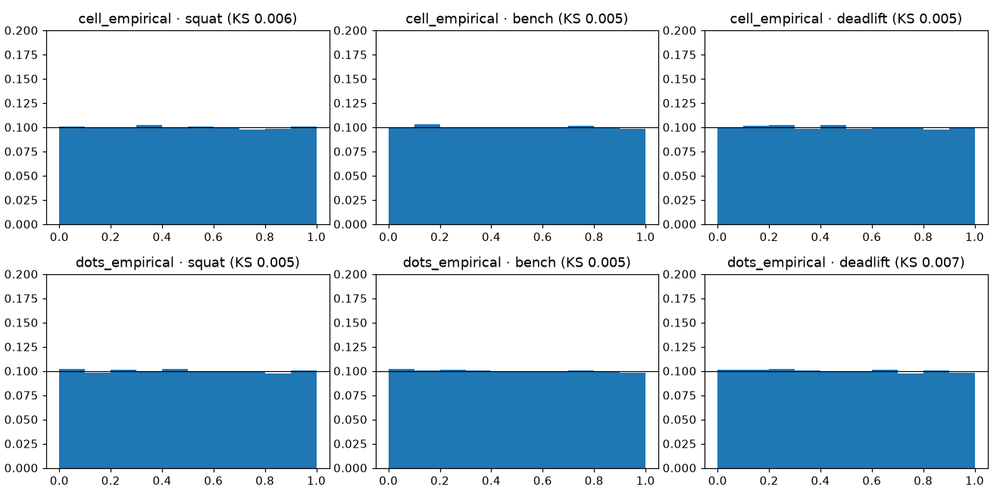
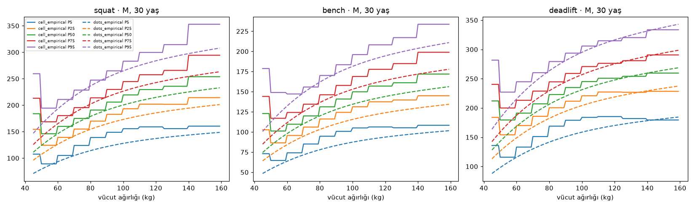
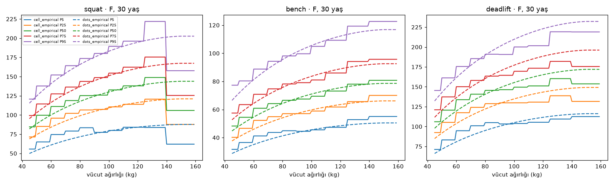

# Temel çizgiler (P049)

Üretim: `make baselines` (`gymml/eval/baselines.py`). Koşum izi: `runs/*-baselines/`.
Adaylar (P050–P052) bu tablodaki **doğrulama** metriklerini geçmek zorundadır. Test kümesi burada kullanılmadı.

## Değerlendirme düzeni

- Veri: `cohort_long.parquet` (P048), referans tanımı `tested = true`, `wraps = false`; örnek ağırlıkları
  ters-frekans (sporcu başına toplam 1).
- Bölme: sporcu kimliğine göre gruplu %70/15/15, tohum `20260101`, dosya `data/processed/splits.parquet`
  (yoksa kohorttan aynı tohumla yeniden üretilir). Özet `9a2c6ae6e0dee826`, sporcu sayıları {'train': 352946, 'test': 75631, 'val': 75631}.
- Ortak arabirim `gymml.eval.interface.DistributionModel`: `fit(df)`, `quantile(x, q)`, `cdf(x, y)`, `params(x)`;
  kaldırış başına ayrı model.
- Metrikler (`gymml.eval.metrics`): 19 çeyrek (0.05…0.95) ortalama ağırlıklı pinball kaybı (kg); CRPS ≈ 2 ×
  pinball; rastgeleleştirilmiş PIT (gözlem ±1.25 kg titreştirilir, kayıtlar 2.5 kg adımlı) histogramı ve
  KS uzaklığı; katman (cinsiyet × yaş bandı × kilo bandı, n ≥ 500) başına 10–90 çeyreklerinde
  |gözlenen − beklenen| kapsamanın en büyüğü. Kapı (§4.3, 2026-11-13 onayı): sapma ≤ max(2 puan,
  gürültü bandı), bandı aşan katman oranı ≤ %10. Gürültü bandı 2.77·√(0.25/n_etkin)
  (9 çeyrekte Bonferroni ile katman başına %95, Kish etkin örneklemi). `2pp_üstü_katman` yalnızca bilgi içindir.
- Akıl sağlığı testleri (`gymml.eval.sanity`): yükte kesin artan CDF; aynı yükte kiloyla artmayan skor
  (tolerans 0.005); yaş eğrisi tek tepeli, tepe 20–40, yıllık
  sıçrama ≤ %4; pürüzsüzlük |Δ²medyan|/medyan ≤ 0.01; eğitim
  aralığı dışı (yaş (10.0, 14.0, 85.0, 95.0), kilo (25.0, 30.0, 250.0, 300.0)) sonlu/pozitif/sıralı/fiziksel sınır içinde.
- Dış doğrulama (`gymml.eval.external`): van den Hoek 2024 özetindeki 90. yüzdelik göreli güç (18–35 ve >80
  yaş, kilo sınıfları toplu; `data/external/`). Model değeri, doğrulama kümesindeki aynı cinsiyet/yaş grubundaki
  kişiler üzerinden toplu göreli güç dağılımının 90. yüzdeliği. 18–35 için ölçüt ±%3.

## Metrikler (doğrulama kümesi)

| model | lift | n_val | pinball_kg | crps_kg | pit_ks | katman | katman_max_pp | 2pp_üstü_katman | bant_dışı_katman | kalibrasyon_kapısı | akıl_sağlığı |
|---|---|---|---|---|---|---|---|---|---|---|---|
| cell_empirical | squat | 80,232 | 9.393 | 18.787 | 0.006 | 39 | 7.108 | 27 | 3 | ✅ | 2/5 |
| cell_empirical | bench | 105,766 | 6.186 | 12.371 | 0.005 | 55 | 10.948 | 34 | 7 | ❌ | 2/5 |
| cell_empirical | deadlift | 89,988 | 9.310 | 18.620 | 0.005 | 45 | 8.809 | 29 | 2 | ✅ | 2/5 |
| dots_empirical | squat | 80,232 | 10.073 | 20.147 | 0.005 | 39 | 38.170 | 39 | 33 | ❌ | 4/5 |
| dots_empirical | bench | 105,766 | 6.734 | 13.468 | 0.005 | 55 | 41.009 | 55 | 46 | ❌ | 4/5 |
| dots_empirical | deadlift | 89,988 | 10.036 | 20.072 | 0.007 | 45 | 37.812 | 45 | 37 | ❌ | 4/5 |

## Akıl sağlığı testleri

| model | lift | test | sonuç | ayrıntı |
|---|---|---|---|---|
| cell_empirical | squat | skor yükte kesin artan (Q05–Q95 arası, 2.5 kg adım) | ✅ | en küçük CDF artışı 1.95e-03 |
| cell_empirical | squat | aynı yükte skor kiloyla artmıyor | ❌ | kilo +1 kg'da en büyük CDF artışı 0.6799 (tolerans 0.005) |
| cell_empirical | squat | yaş eğrisi tek tepeli, tepe 20–40, sıçrama yok | ❌ | tepe yaşı M/F [19.0, 19.0], en büyük yıllık değişim 0.414, tek tepeli=False |
| cell_empirical | squat | pürüzsüzlük (ikinci fark sınırı) | ❌ | en büyük |Δ²medyan|/medyan 0.6606 (sınır 0.01) |
| cell_empirical | squat | eğitim aralığı dışında makul davranış | ✅ | sonlu, pozitif, sıralı, fiziksel sınır içinde |
| cell_empirical | bench | skor yükte kesin artan (Q05–Q95 arası, 2.5 kg adım) | ✅ | en küçük CDF artışı 4.05e-03 |
| cell_empirical | bench | aynı yükte skor kiloyla artmıyor | ❌ | kilo +1 kg'da en büyük CDF artışı 0.6380 (tolerans 0.005) |
| cell_empirical | bench | yaş eğrisi tek tepeli, tepe 20–40, sıçrama yok | ❌ | tepe yaşı M/F [35.0, 19.0], en büyük yıllık değişim 0.162, tek tepeli=True |
| cell_empirical | bench | pürüzsüzlük (ikinci fark sınırı) | ❌ | en büyük |Δ²medyan|/medyan 0.6373 (sınır 0.01) |
| cell_empirical | bench | eğitim aralığı dışında makul davranış | ✅ | sonlu, pozitif, sıralı, fiziksel sınır içinde |
| cell_empirical | deadlift | skor yükte kesin artan (Q05–Q95 arası, 2.5 kg adım) | ✅ | en küçük CDF artışı 1.97e-03 |
| cell_empirical | deadlift | aynı yükte skor kiloyla artmıyor | ❌ | kilo +1 kg'da en büyük CDF artışı 0.6402 (tolerans 0.005) |
| cell_empirical | deadlift | yaş eğrisi tek tepeli, tepe 20–40, sıçrama yok | ❌ | tepe yaşı M/F [24.0, 24.0], en büyük yıllık değişim 0.160, tek tepeli=True |
| cell_empirical | deadlift | pürüzsüzlük (ikinci fark sınırı) | ❌ | en büyük |Δ²medyan|/medyan 0.4623 (sınır 0.01) |
| cell_empirical | deadlift | eğitim aralığı dışında makul davranış | ✅ | sonlu, pozitif, sıralı, fiziksel sınır içinde |
| dots_empirical | squat | skor yükte kesin artan (Q05–Q95 arası, 2.5 kg adım) | ✅ | en küçük CDF artışı 5.11e-03 |
| dots_empirical | squat | aynı yükte skor kiloyla artmıyor | ✅ | kilo +1 kg'da en büyük CDF artışı 0.0000 (tolerans 0.005) |
| dots_empirical | squat | yaş eğrisi tek tepeli, tepe 20–40, sıçrama yok | ❌ | tepe yaşı M/F [16.0, 16.0], en büyük yıllık değişim 0.000, tek tepeli=True |
| dots_empirical | squat | pürüzsüzlük (ikinci fark sınırı) | ✅ | en büyük |Δ²medyan|/medyan 0.0004 (sınır 0.01) |
| dots_empirical | squat | eğitim aralığı dışında makul davranış | ✅ | sonlu, pozitif, sıralı, fiziksel sınır içinde |
| dots_empirical | bench | skor yükte kesin artan (Q05–Q95 arası, 2.5 kg adım) | ✅ | en küçük CDF artışı 7.63e-03 |
| dots_empirical | bench | aynı yükte skor kiloyla artmıyor | ✅ | kilo +1 kg'da en büyük CDF artışı 0.0000 (tolerans 0.005) |
| dots_empirical | bench | yaş eğrisi tek tepeli, tepe 20–40, sıçrama yok | ❌ | tepe yaşı M/F [16.0, 16.0], en büyük yıllık değişim 0.000, tek tepeli=True |
| dots_empirical | bench | pürüzsüzlük (ikinci fark sınırı) | ✅ | en büyük |Δ²medyan|/medyan 0.0004 (sınır 0.01) |
| dots_empirical | bench | eğitim aralığı dışında makul davranış | ✅ | sonlu, pozitif, sıralı, fiziksel sınır içinde |
| dots_empirical | deadlift | skor yükte kesin artan (Q05–Q95 arası, 2.5 kg adım) | ✅ | en küçük CDF artışı 4.93e-03 |
| dots_empirical | deadlift | aynı yükte skor kiloyla artmıyor | ✅ | kilo +1 kg'da en büyük CDF artışı 0.0000 (tolerans 0.005) |
| dots_empirical | deadlift | yaş eğrisi tek tepeli, tepe 20–40, sıçrama yok | ❌ | tepe yaşı M/F [16.0, 16.0], en büyük yıllık değişim 0.000, tek tepeli=True |
| dots_empirical | deadlift | pürüzsüzlük (ikinci fark sınırı) | ✅ | en büyük |Δ²medyan|/medyan 0.0004 (sınır 0.01) |
| dots_empirical | deadlift | eğitim aralığı dışında makul davranış | ✅ | sonlu, pozitif, sıralı, fiziksel sınır içinde |

## Dış doğrulama: van den Hoek 2024

| model | sex | lift | age_group | n | vdh | model_oran | veri_ağırlıksız | fark_% | geçti |
|---|---|---|---|---|---|---|---|---|---|
| cell_empirical | M | squat | 18-35 | 37,242 | 2.830 | 2.764 | 2.860 | -2.349 | True |
| cell_empirical | F | squat | 18-35 | 16,605 | 2.260 | 2.187 | 2.300 | -3.244 | False |
| cell_empirical | M | squat | >80 | 39 | 1.720 | 2.164 | 1.618 | 25.786 | None |
| cell_empirical | F | squat | >80 | 9 | 1.010 | 2.616 | 1.190 | 158.973 | None |
| cell_empirical | M | bench | 18-35 | 47,426 | 1.950 | 1.872 | 1.928 | -3.991 | False |
| cell_empirical | F | bench | 18-35 | 19,481 | 1.350 | 1.244 | 1.335 | -7.852 | False |
| cell_empirical | M | bench | >80 | 80 | 1.310 | 1.457 | 1.263 | 11.205 | None |
| cell_empirical | F | bench | >80 | 13 | 0.920 | 1.108 | 0.755 | 20.410 | None |
| cell_empirical | M | deadlift | 18-35 | 41,227 | 3.250 | 3.153 | 3.259 | -2.978 | True |
| cell_empirical | F | deadlift | 18-35 | 18,158 | 2.660 | 2.559 | 2.672 | -3.782 | False |
| cell_empirical | M | deadlift | >80 | 60 | 2.300 | 2.884 | 2.253 | 25.386 | None |
| cell_empirical | F | deadlift | >80 | 15 | 1.680 | 2.147 | 1.605 | 27.805 | None |
| dots_empirical | M | squat | 18-35 | 37,242 | 2.830 | 2.725 | 2.860 | -3.698 | False |
| dots_empirical | F | squat | 18-35 | 16,605 | 2.260 | 2.118 | 2.300 | -6.280 | False |
| dots_empirical | M | squat | >80 | 39 | 1.720 | 2.882 | 1.618 | 67.564 | None |
| dots_empirical | F | squat | >80 | 9 | 1.010 | 2.216 | 1.190 | 119.406 | None |
| dots_empirical | M | bench | 18-35 | 47,426 | 1.950 | 1.857 | 1.928 | -4.787 | False |
| dots_empirical | F | bench | 18-35 | 19,481 | 1.350 | 1.200 | 1.335 | -11.084 | False |
| dots_empirical | M | bench | >80 | 80 | 1.310 | 1.941 | 1.263 | 48.154 | None |
| dots_empirical | F | bench | >80 | 13 | 0.920 | 1.225 | 0.755 | 33.191 | None |
| dots_empirical | M | deadlift | 18-35 | 41,227 | 3.250 | 3.063 | 3.259 | -5.747 | False |
| dots_empirical | F | deadlift | 18-35 | 18,158 | 2.660 | 2.455 | 2.672 | -7.695 | False |
| dots_empirical | M | deadlift | >80 | 60 | 2.300 | 3.232 | 2.253 | 40.507 | None |
| dots_empirical | F | deadlift | >80 | 15 | 1.680 | 2.539 | 1.605 | 51.102 | None |

## Yüzdelik eğrileri

## Yorum

- Pinball'da hücre bazlı ampirik model 3/3 kaldırışta DOTS temel çizgisinden iyi (squat, bench, deadlift): DOTS yaşı hiç kullanmaz ve kilo eğrisini tek bir formüle bağlar.
- Hücre modeli bant sınırlarında basamaklıdır; pürüzsüzlük ve kiloda artmama testlerini bu yüzden
  geçemeyebilir. DOTS kiloda pürüzsüz ama yaş etkisi olmadığından yaş testi ve gençlerde/yaşlılarda
  kalibrasyon kapısı başarısız olur. Bunlar beklenen zayıflıklardır; adaylar hepsini birlikte
  geçmelidir.
- Kalibrasyon kapısı ve örnekleme gürültüsü: hücre modeli katmanlarla aynı hücrelerde eğitildiği hâlde
  doğrulamada birçok katmanda 2 puanı aşıyor; sapma 1/√n ile ölçekleniyor (bench'te r ≈ 0.6). Ters-
  frekans ağırlıklarıyla n = 500'lük katmanın etkin örneklemi daha da küçük, gürültü bandı 5–8 puan.
  Bu yüzden §4.3 kapısı 2026-11-13'te kullanıcı onayıyla gürültüye duyarlı hâle getirildi.
- Yaş tepesi ölçütü ham veride tepe 27–34 (bench 32–41) olduğundan onayla 20–40 aralığına çekildi.
- vdH ölçütü P053'te ağırlıklandırma açık/kapalı iki sürümle raporlanır; karşılaştırma ağırlıksız sürümle.
