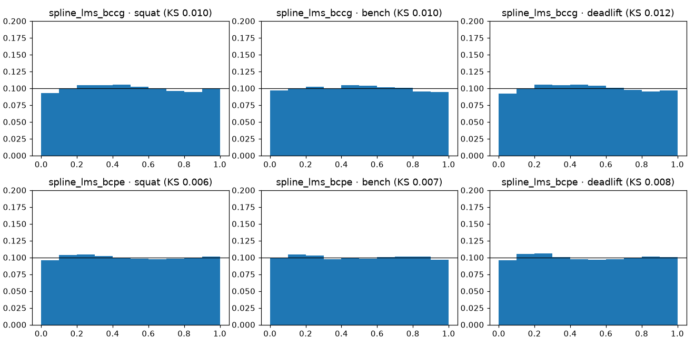
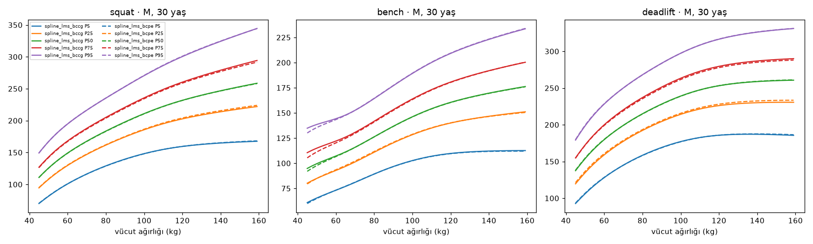
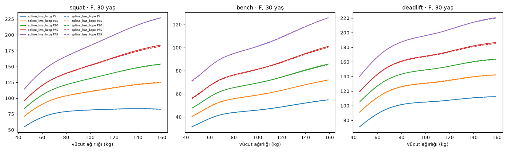
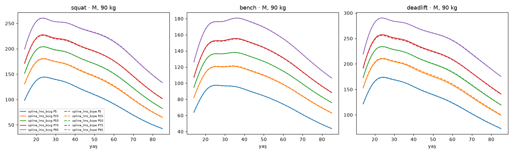
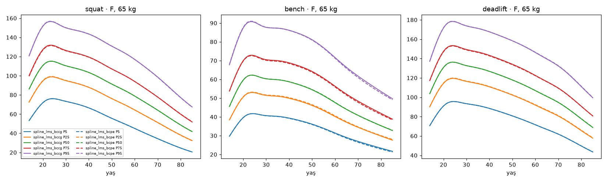

# Aday A — Spline-LMS (P050)

Üretim: `make train-a` (`gymml/models/train_a.py`, model `gymml/models/spline_lms.py`, dağılımlar
`gymml/models/boxcox.py`). Koşum izi: `runs/20261113T113634Z-candidate_a/` (metrikler, katsayılar JSON). Değerlendirme P049
koşumuyla (`gymml.eval.runner.evaluate_factory`) **doğrulama** kümesinde; test kümesi kullanılmadı.
Bölme özeti `9a2c6ae6e0dee826`, sporcu sayıları {'train': 352946, 'test': 75631, 'val': 75631}.

## Model

- Kaldırış × cinsiyet başına `Y ~ BCCG(μ, σ, ν)` veya `BCPE(μ, σ, ν, τ)`; bağlantılar log μ, log σ, ν
  (birim), log τ. Her parametre yaş × log-kilo kübik B-spline tensör çarpımı tabanında doğrusal
  (dört parametre aynı tabanı paylaşır); katsayı ızgarasında her eksen boyunca ikinci fark (P-spline) cezası.
- Dağılım fonksiyonları (log-yoğunluk, CDF, ters CDF) elle yazıldı; `tests/test_spline_lms.py`
  scipy `truncnorm`/`gennorm` ve sayısal integrasyonla doğruluyor. BCPE'deki kesilme terimi
  P(1/τ, x)'in τ'ya göre türevini ister; torch bunu vermediği için merkezi farklı özel autograd fonksiyonu.
- Amaç: P048 örnek ağırlıklarıyla ağırlıklı ortalama NLL + ceza. Adam ısınması → L-BFGS (strong Wolfe).
  Erken durdurma: eğitim kümesinin %10'u sporcu bazında iç doğrulama payı olarak ayrılır; en iyi iç
  doğrulama NLL'li katsayılar tutulur (dış doğrulama kümesi yalnızca değerlendirme içindir).
- Eğitim aralığı dışındaki yaş/kilo aralık sınırına kırpılır (sabit dışdeğerleme).

Temel yapılandırma (`configs/spline_lms.yaml`; P053'te aranacak):

```yaml
# P050 Aday A — Spline-LMS temel yapılandırması (P053'te Optuna ile aranacak).
# Düğümler: yaş [age_min, age_max] ve log-kilo [log bw_min, log bw_max] üzerinde eşit aralıklı,
# kübik; taban sayısı = segment + derece. Dört parametre aynı tensör tabanını paylaşır.
family: BCPE
degree: 3
age_segments: 10
bw_segments: 8
age_min: 14.0
age_max: 85.0
bw_min: 30.0
bw_max: 250.0
penalties:
  mu: {age: 0.001, bw: 0.001}
  sigma: {age: 0.01, bw: 0.01}
  nu: {age: 0.1, bw: 0.1}
  tau: {age: 0.1, bw: 0.1}
adam_steps: 300
adam_lr: 0.05
lbfgs_rounds: 30
lbfgs_iter: 20
patience: 3
min_improvement: 0.000001
holdout_frac: 0.1
seed: 20260101
```

## Metrikler (doğrulama kümesi, temel çizgilerle)

| model | lift | n_val | pinball_kg | crps_kg | pit_ks | katman | katman_max_pp | 2pp_üstü_katman | bant_dışı_katman | kalibrasyon_kapısı | akıl_sağlığı |
|---|---|---|---|---|---|---|---|---|---|---|---|
| cell_empirical | squat | 80,232 | 9.393 | 18.787 | 0.006 | 39 | 7.108 | 27 | 3 | ✅ | 2/5 |
| cell_empirical | bench | 105,766 | 6.186 | 12.371 | 0.005 | 55 | 10.948 | 34 | 7 | ❌ | 2/5 |
| cell_empirical | deadlift | 89,988 | 9.310 | 18.620 | 0.005 | 45 | 8.809 | 29 | 2 | ✅ | 2/5 |
| dots_empirical | squat | 80,232 | 10.073 | 20.147 | 0.005 | 39 | 38.170 | 39 | 33 | ❌ | 4/5 |
| dots_empirical | bench | 105,766 | 6.734 | 13.468 | 0.005 | 55 | 41.009 | 55 | 46 | ❌ | 4/5 |
| dots_empirical | deadlift | 89,988 | 10.036 | 20.072 | 0.007 | 45 | 37.812 | 45 | 37 | ❌ | 4/5 |
| spline_lms_bccg | squat | 80,232 | 9.147 | 18.294 | 0.010 | 39 | 7.374 | 34 | 11 | ❌ | 4/5 |
| spline_lms_bccg | bench | 105,766 | 6.045 | 12.090 | 0.010 | 55 | 8.071 | 44 | 7 | ❌ | 4/5 |
| spline_lms_bccg | deadlift | 89,988 | 9.068 | 18.136 | 0.012 | 45 | 7.621 | 36 | 12 | ❌ | 4/5 |
| spline_lms_bcpe | squat | 80,232 | 9.145 | 18.290 | 0.006 | 39 | 7.098 | 33 | 8 | ❌ | 4/5 |
| spline_lms_bcpe | bench | 105,766 | 6.044 | 12.088 | 0.007 | 55 | 8.308 | 42 | 7 | ❌ | 4/5 |
| spline_lms_bcpe | deadlift | 89,988 | 9.065 | 18.130 | 0.008 | 45 | 6.645 | 36 | 6 | ❌ | 4/5 |



## BCCG ve BCPE karşılaştırması

Parametreler 30 yaş, tipik kiloda (E 90 kg, K 65 kg). `val_loglik` ağırlıklı ortalama log-yoğunluk.

| model | lift | val_loglik | pinball_kg | pit_ks | bant_dışı_katman | kalibrasyon_kapısı | σ M/F | ν M/F | τ M/F | parametre | eğitim_s |
|---|---|---|---|---|---|---|---|---|---|---|---|
| spline_lms_bccg | squat | -4.8351 | 9.1469 | 0.0103 | 11 | ❌ | 0.174/0.212 | 1.18/0.82 | 2.00/2.00 | 858 | 76.9264 |
| spline_lms_bcpe | squat | -4.8339 | 9.1449 | 0.0063 | 8 | ❌ | 0.175/0.212 | 1.14/0.80 | 1.75/1.88 | 1,144 | 124.4394 |
| spline_lms_bccg | bench | -4.4007 | 6.0452 | 0.0103 | 7 | ❌ | 0.179/0.233 | 0.97/0.13 | 2.00/2.00 | 858 | 119.8455 |
| spline_lms_bcpe | bench | -4.3994 | 6.0442 | 0.0068 | 7 | ❌ | 0.179/0.233 | 0.95/0.13 | 1.79/1.83 | 1,144 | 228.3475 |
| spline_lms_bccg | deadlift | -4.8357 | 9.0681 | 0.0117 | 12 | ❌ | 0.152/0.184 | 1.24/0.86 | 2.00/2.00 | 858 | 59.5435 |
| spline_lms_bcpe | deadlift | -4.8332 | 9.0651 | 0.0084 | 6 | ❌ | 0.152/0.184 | 1.23/0.85 | 1.67/1.86 | 1,144 | 94.0556 |

## Akıl sağlığı testleri

| model | lift | test | sonuç | ayrıntı |
|---|---|---|---|---|
| spline_lms_bccg | squat | skor yükte kesin artan (Q05–Q95 arası, 2.5 kg adım) | ✅ | en küçük CDF artışı 5.78e-03 |
| spline_lms_bccg | squat | aynı yükte skor kiloyla artmıyor | ✅ | kilo +1 kg'da en büyük CDF artışı 0.0003 (tolerans 0.005) |
| spline_lms_bccg | squat | yaş eğrisi tek tepeli, tepe 20–40, sıçrama yok | ❌ | tepe yaşı M/F [24.0, 24.0], en büyük yıllık değişim 0.049, tek tepeli=True |
| spline_lms_bccg | squat | pürüzsüzlük (ikinci fark sınırı) | ✅ | en büyük |Δ²medyan|/medyan 0.0071 (sınır 0.01) |
| spline_lms_bccg | squat | eğitim aralığı dışında makul davranış | ✅ | sonlu, pozitif, sıralı, fiziksel sınır içinde |
| spline_lms_bccg | bench | skor yükte kesin artan (Q05–Q95 arası, 2.5 kg adım) | ✅ | en küçük CDF artışı 8.44e-03 |
| spline_lms_bccg | bench | aynı yükte skor kiloyla artmıyor | ✅ | kilo +1 kg'da en büyük CDF artışı -0.0000 (tolerans 0.005) |
| spline_lms_bccg | bench | yaş eğrisi tek tepeli, tepe 20–40, sıçrama yok | ❌ | tepe yaşı M/F [35.0, 24.0], en büyük yıllık değişim 0.056, tek tepeli=True |
| spline_lms_bccg | bench | pürüzsüzlük (ikinci fark sınırı) | ✅ | en büyük |Δ²medyan|/medyan 0.0076 (sınır 0.01) |
| spline_lms_bccg | bench | eğitim aralığı dışında makul davranış | ✅ | sonlu, pozitif, sıralı, fiziksel sınır içinde |
| spline_lms_bccg | deadlift | skor yükte kesin artan (Q05–Q95 arası, 2.5 kg adım) | ✅ | en küçük CDF artışı 6.05e-03 |
| spline_lms_bccg | deadlift | aynı yükte skor kiloyla artmıyor | ✅ | kilo +1 kg'da en büyük CDF artışı 0.0009 (tolerans 0.005) |
| spline_lms_bccg | deadlift | yaş eğrisi tek tepeli, tepe 20–40, sıçrama yok | ❌ | tepe yaşı M/F [24.0, 24.0], en büyük yıllık değişim 0.049, tek tepeli=True |
| spline_lms_bccg | deadlift | pürüzsüzlük (ikinci fark sınırı) | ✅ | en büyük |Δ²medyan|/medyan 0.0071 (sınır 0.01) |
| spline_lms_bccg | deadlift | eğitim aralığı dışında makul davranış | ✅ | sonlu, pozitif, sıralı, fiziksel sınır içinde |
| spline_lms_bcpe | squat | skor yükte kesin artan (Q05–Q95 arası, 2.5 kg adım) | ✅ | en küçük CDF artışı 5.20e-03 |
| spline_lms_bcpe | squat | aynı yükte skor kiloyla artmıyor | ✅ | kilo +1 kg'da en büyük CDF artışı 0.0003 (tolerans 0.005) |
| spline_lms_bcpe | squat | yaş eğrisi tek tepeli, tepe 20–40, sıçrama yok | ❌ | tepe yaşı M/F [23.0, 24.0], en büyük yıllık değişim 0.050, tek tepeli=True |
| spline_lms_bcpe | squat | pürüzsüzlük (ikinci fark sınırı) | ✅ | en büyük |Δ²medyan|/medyan 0.0072 (sınır 0.01) |
| spline_lms_bcpe | squat | eğitim aralığı dışında makul davranış | ✅ | sonlu, pozitif, sıralı, fiziksel sınır içinde |
| spline_lms_bcpe | bench | skor yükte kesin artan (Q05–Q95 arası, 2.5 kg adım) | ✅ | en küçük CDF artışı 7.88e-03 |
| spline_lms_bcpe | bench | aynı yükte skor kiloyla artmıyor | ✅ | kilo +1 kg'da en büyük CDF artışı -0.0001 (tolerans 0.005) |
| spline_lms_bcpe | bench | yaş eğrisi tek tepeli, tepe 20–40, sıçrama yok | ❌ | tepe yaşı M/F [35.0, 24.0], en büyük yıllık değişim 0.056, tek tepeli=True |
| spline_lms_bcpe | bench | pürüzsüzlük (ikinci fark sınırı) | ✅ | en büyük |Δ²medyan|/medyan 0.0076 (sınır 0.01) |
| spline_lms_bcpe | bench | eğitim aralığı dışında makul davranış | ✅ | sonlu, pozitif, sıralı, fiziksel sınır içinde |
| spline_lms_bcpe | deadlift | skor yükte kesin artan (Q05–Q95 arası, 2.5 kg adım) | ✅ | en küçük CDF artışı 5.63e-03 |
| spline_lms_bcpe | deadlift | aynı yükte skor kiloyla artmıyor | ✅ | kilo +1 kg'da en büyük CDF artışı 0.0009 (tolerans 0.005) |
| spline_lms_bcpe | deadlift | yaş eğrisi tek tepeli, tepe 20–40, sıçrama yok | ❌ | tepe yaşı M/F [24.0, 24.0], en büyük yıllık değişim 0.050, tek tepeli=True |
| spline_lms_bcpe | deadlift | pürüzsüzlük (ikinci fark sınırı) | ✅ | en büyük |Δ²medyan|/medyan 0.0072 (sınır 0.01) |
| spline_lms_bcpe | deadlift | eğitim aralığı dışında makul davranış | ✅ | sonlu, pozitif, sıralı, fiziksel sınır içinde |

## Dış doğrulama: van den Hoek 2024

| model | sex | lift | age_group | n | vdh | model_oran | veri_ağırlıksız | fark_% | geçti |
|---|---|---|---|---|---|---|---|---|---|
| spline_lms_bccg | M | squat | 18-35 | 37,242 | 2.830 | 2.768 | 2.860 | -2.196 | True |
| spline_lms_bccg | F | squat | 18-35 | 16,605 | 2.260 | 2.180 | 2.300 | -3.540 | False |
| spline_lms_bccg | M | squat | >80 | 39 | 1.720 | 1.597 | 1.618 | -7.142 | None |
| spline_lms_bccg | F | squat | >80 | 9 | 1.010 | 1.119 | 1.190 | 10.770 | None |
| spline_lms_bccg | M | bench | 18-35 | 47,426 | 1.950 | 1.879 | 1.928 | -3.641 | False |
| spline_lms_bccg | F | bench | 18-35 | 19,481 | 1.350 | 1.243 | 1.335 | -7.949 | False |
| spline_lms_bccg | M | bench | >80 | 80 | 1.310 | 1.253 | 1.263 | -4.375 | None |
| spline_lms_bccg | F | bench | >80 | 13 | 0.920 | 0.796 | 0.755 | -13.478 | None |
| spline_lms_bccg | M | deadlift | 18-35 | 41,227 | 3.250 | 3.166 | 3.259 | -2.586 | True |
| spline_lms_bccg | F | deadlift | 18-35 | 18,158 | 2.660 | 2.550 | 2.672 | -4.142 | False |
| spline_lms_bccg | M | deadlift | >80 | 60 | 2.300 | 2.196 | 2.253 | -4.500 | None |
| spline_lms_bccg | F | deadlift | >80 | 15 | 1.680 | 1.661 | 1.605 | -1.124 | None |
| spline_lms_bcpe | M | squat | 18-35 | 37,242 | 2.830 | 2.763 | 2.860 | -2.368 | True |
| spline_lms_bcpe | F | squat | 18-35 | 16,605 | 2.260 | 2.177 | 2.300 | -3.664 | False |
| spline_lms_bcpe | M | squat | >80 | 39 | 1.720 | 1.592 | 1.618 | -7.434 | None |
| spline_lms_bcpe | F | squat | >80 | 9 | 1.010 | 1.119 | 1.190 | 10.826 | None |
| spline_lms_bcpe | M | bench | 18-35 | 47,426 | 1.950 | 1.873 | 1.928 | -3.951 | False |
| spline_lms_bcpe | F | bench | 18-35 | 19,481 | 1.350 | 1.240 | 1.335 | -8.166 | False |
| spline_lms_bcpe | M | bench | >80 | 80 | 1.310 | 1.249 | 1.263 | -4.639 | None |
| spline_lms_bcpe | F | bench | >80 | 13 | 0.920 | 0.788 | 0.755 | -14.299 | None |
| spline_lms_bcpe | M | deadlift | 18-35 | 41,227 | 3.250 | 3.156 | 3.259 | -2.883 | True |
| spline_lms_bcpe | F | deadlift | 18-35 | 18,158 | 2.660 | 2.546 | 2.672 | -4.278 | False |
| spline_lms_bcpe | M | deadlift | >80 | 60 | 2.300 | 2.189 | 2.253 | -4.826 | None |
| spline_lms_bcpe | F | deadlift | >80 | 15 | 1.680 | 1.661 | 1.605 | -1.144 | None |

## Yüzdelik eğrileri (5/25/50/75/95)

Kiloya karşı, 30 yaş:





Yaşa karşı, tipik kilo:





## Yorum

- `spline_lms_bccg`: pinball'da en iyi temel çizgiyi (hücre ampirik) 3/3 kaldırışta geçiyor (iyileşme squat +2.6%, bench +2.3%, deadlift +2.6%); akıl sağlığı 12/15.
- `spline_lms_bcpe`: pinball'da en iyi temel çizgiyi (hücre ampirik) 3/3 kaldırışta geçiyor (iyileşme squat +2.6%, bench +2.3%, deadlift +2.6%); akıl sağlığı 12/15.
- BCPE − BCCG doğrulama log-olabilirliği (gözlem başına, nat): squat +0.0012, bench +0.0014, deadlift +0.0025. τ ≠ 2 kuyruk kalınlığını serbest bırakır; fark küçükse BCCG daha basit seçenektir (P053'te aile de aranacak).
- Yaş ölçütünü bozan > %4'lük yıllık medyan değişimi yalnızca şu yaşlardan bir sonrakine geçişte: spline_lms_bccg/squat/M: 16, 17; spline_lms_bccg/squat/F: 16, 17; spline_lms_bccg/bench/M: 16, 17; spline_lms_bccg/bench/F: 16, 17; spline_lms_bccg/deadlift/M: 16, 17; spline_lms_bccg/deadlift/F: 16; spline_lms_bcpe/squat/M: 16, 17; spline_lms_bcpe/squat/F: 16, 17; spline_lms_bcpe/bench/M: 16, 17; spline_lms_bcpe/bench/F: 16, 17; spline_lms_bcpe/deadlift/M: 16, 17; spline_lms_bcpe/deadlift/F: 16. Ham eğitim verisi de bu yaşlarda > %4 artıyor (ör. erkek squat medyan kg/kilo^(2/3): 16→17 +%7, 17→18 +%4); yani ölçüt ergenlik dönemi büyümesiyle çelişiyor (P053 öncesi kullanıcıya açık soru); tepe yaşı ve tek tepelilik her durumda geçiyor.
- Kalibrasyon bandı dışındaki katmanların cinsiyet × yaş bandına dağılımı (iki aile, üç kaldırış toplamı): M 19-23: 22, M 14-18: 13, M 24-34: 13, F 19-23: 1, F 50-59: 1, M 60-69: 1. Hata gençlerde (yaşla hızlı değişen bölge) yoğun; yaş düğümü aralığı (~7 yıl) bu bölge için kaba. P053'te düğüm sayısı / yaş cezası aranmalı veya yaş ekseni dönüştürülmeli (ör. log yaş).
