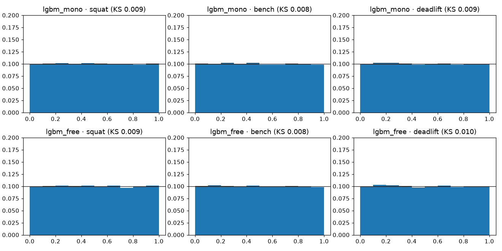
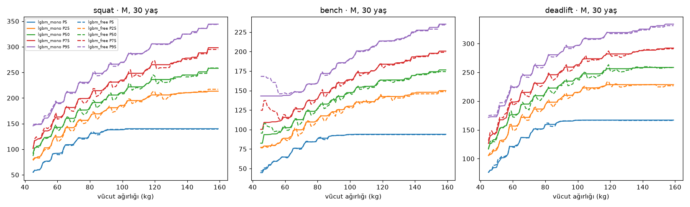
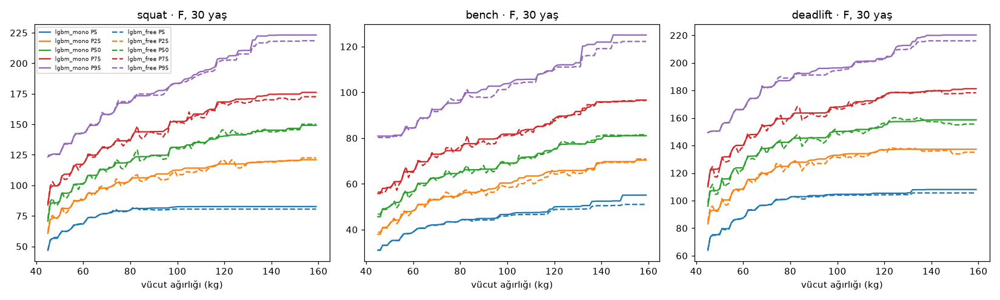
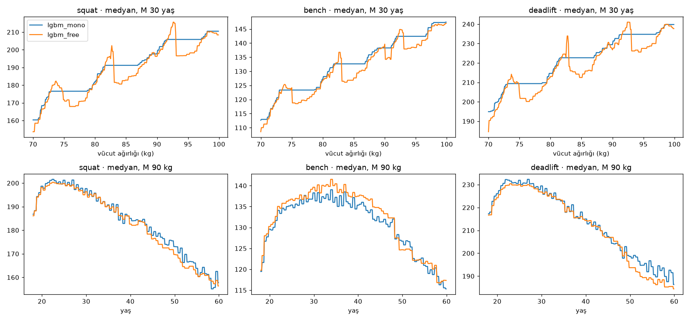

# Aday B — LightGBM çeyreklik (P051)

Üretim: `make train-b` (`gymml/models/train_b.py`, model `gymml/models/lgbm_quantile.py`).
Koşum izi: `runs/*-candidate_b/`. Değerlendirme P049 ortak koşumu
(`gymml.eval.runner.evaluate_factory`),
**doğrulama** kümesi; test kümesi kullanılmadı. Bölme özeti `9a2c6ae6e0dee826` (temel çizgilerle
aynı).

## Model

- Kaldırış başına 19 ayrı LightGBM (q = 0.05…0.95), girdiler cinsiyet, yaş, kilo, log-kilo.
- Hedef standartlaştırılmış log-yük; kayıtlar 2.5 kg adımlı olduğundan eğitimden önce ±1.25 kg
  titreştirilir
  (temel çizgilerle aynı varsayım). Örnek ağırlıkları `weight` (sporcu başına toplam 1).
- **Pinball kaybı özel hedef olarak** yazıldı: LightGBM'in yerleşik `quantile` hedefi
  `monotone_constraints` ile birlikte kullanılamıyor (yaprakları ağaç kurulduktan sonra yeniden
  hesaplar).
  Kısıtlı (`lgbm_mono`: kilo ve log-kilo artan) ve kısıtsız (`lgbm_free`) sürümler aynı hedefi ve
  aynı
  hiperparametreleri kullanır: 400 tur, {'learning_rate': 0.1, 'num_leaves': 15, 'min_data_in_leaf': 200, 'bagging_fraction': 0.8, 'bagging_freq': 1, 'num_threads': 0, 'verbose': -1}. Hiperparametre araması P053'te.
- Kesişme: 19 çeyrek satır başına yeniden sıralanır (izotonik yeniden sıralama). Oranlar aşağıda.
- Kuyruk (< 0.05, > 0.95): log Q – lojit(p) ölçeğinde doğrusal ekstrapolasyon; eğim her uçta en
  dıştaki
  4 çeyreğin en küçük kareler doğrusundan, genel 5–95 eğiminin 0.25–
  2.0 katına kırpılarak. **Zayıflık:** kuyruk biçimi veriden öğrenilmez
  (yalnızca dış
  çeyreklerin eğimini taşır); P1–P4 ve P96–P99 skorları kaba ve satırdan satıra gürültülüdür; eğim
  kiloyla
  değiştiği için kuyruk bölgesinde kiloda monotonluk garanti değildir. İlk deneme (yalnızca iki
  komşu
  çeyreğin eğimi) sentetik veride Q99/Q95'i gerçeğin ~1.5 katı kadar şişirdi; bu yüzden kırpma
  eklendi.
- Sürekli CDF: 19 çeyrek lojit(p) ölçeğinde doğrusal enterpole edilip 0.005…0.995 ızgarasına
  taşınır,
  ızgarada doğrusal CDF (`QuantileGridMixin`).
- Toplam eğitim süresi (3 kaldırış): lgbm_mono 291 s, lgbm_free 207 s.

## Metrikler (doğrulama kümesi)

| model | lift | n_val | pinball_kg | crps_kg | pit_ks | katman | katman_max_pp | 2pp_üstü_katman | bant_dışı_katman | kalibrasyon_kapısı | akıl_sağlığı |
|---|---|---|---|---|---|---|---|---|---|---|---|
| lgbm_mono | squat | 80,232 | 9.073 | 18.146 | 0.009 | 39 | 8.130 | 24 | 1 | ✅ | 2/5 |
| lgbm_mono | bench | 105,766 | 6.013 | 12.026 | 0.008 | 55 | 10.339 | 42 | 4 | ✅ | 2/5 |
| lgbm_mono | deadlift | 89,988 | 9.016 | 18.032 | 0.009 | 45 | 8.671 | 32 | 3 | ✅ | 2/5 |
| lgbm_free | squat | 80,232 | 9.019 | 18.039 | 0.009 | 39 | 5.545 | 27 | 0 | ✅ | 2/5 |
| lgbm_free | bench | 105,766 | 5.991 | 11.982 | 0.008 | 55 | 9.687 | 36 | 4 | ✅ | 2/5 |
| lgbm_free | deadlift | 89,988 | 8.967 | 17.934 | 0.010 | 45 | 8.394 | 29 | 2 | ✅ | 2/5 |

### Temel çizgilerle pinball karşılaştırması (kg; `reports/baselines.md`)

| lift | lgbm_mono | lgbm_free | cell_empirical | dots_empirical | mono_vs_en_iyi_temel_% |
|---|---|---|---|---|---|
| squat | 9.073 | 9.019 | 9.393 | 10.073 | -3.408 |
| bench | 6.013 | 5.991 | 6.186 | 6.734 | -2.791 |
| deadlift | 9.016 | 8.967 | 9.310 | 10.036 | -3.156 |

## Kesişme, boyut ve çıkarım süresi

Boyut: 19 ağacın LightGBM metin dökümü toplamı (sıkıştırmasız). Tek çıkarım: Python'da bir satır
için
19 çeyrek + ızgara + enterpolasyon (50 tekrar ortalaması); cihazdaki Core ML süresi değildir.

| model | lift | kesişme_eğitim_% | kesişme_doğrulama_% | boyut_MB | boyut<1MB | tek_çıkarım_ms | çıkarım<1ms |
|---|---|---|---|---|---|---|---|
| lgbm_mono | squat | 2.125 | 2.177 | 13.818 | ❌ | 0.704 | ✅ |
| lgbm_free | squat | 1.399 | 1.412 | 13.711 | ❌ | 0.671 | ✅ |
| lgbm_mono | bench | 2.323 | 2.297 | 13.840 | ❌ | 0.646 | ✅ |
| lgbm_free | bench | 1.454 | 1.494 | 13.714 | ❌ | 0.664 | ✅ |
| lgbm_mono | deadlift | 1.731 | 1.745 | 13.838 | ❌ | 0.667 | ✅ |
| lgbm_free | deadlift | 1.379 | 1.587 | 13.715 | ❌ | 0.654 | ✅ |

## Akıl sağlığı testleri

| model | lift | test | sonuç | ayrıntı |
|---|---|---|---|---|
| lgbm_mono | squat | skor yükte kesin artan (Q05–Q95 arası, 2.5 kg adım) | ✅ | en küçük CDF artışı 2.44e-03 |
| lgbm_mono | squat | aynı yükte skor kiloyla artmıyor | ❌ | kilo +1 kg'da en büyük CDF artışı 0.0097 (tolerans 0.005) |
| lgbm_mono | squat | yaş eğrisi tek tepeli, tepe 20–40, sıçrama yok | ❌ | tepe yaşı M/F [27.0, 24.0], en büyük yıllık değişim 0.102, tek tepeli=False |
| lgbm_mono | squat | pürüzsüzlük (ikinci fark sınırı) | ❌ | en büyük |Δ²medyan|/medyan 0.1527 (sınır 0.01) |
| lgbm_mono | squat | eğitim aralığı dışında makul davranış | ✅ | sonlu, pozitif, sıralı, fiziksel sınır içinde |
| lgbm_mono | bench | skor yükte kesin artan (Q05–Q95 arası, 2.5 kg adım) | ✅ | en küçük CDF artışı 3.98e-03 |
| lgbm_mono | bench | aynı yükte skor kiloyla artmıyor | ❌ | kilo +1 kg'da en büyük CDF artışı 0.0052 (tolerans 0.005) |
| lgbm_mono | bench | yaş eğrisi tek tepeli, tepe 20–40, sıçrama yok | ❌ | tepe yaşı M/F [34.0, 25.0], en büyük yıllık değişim 0.089, tek tepeli=False |
| lgbm_mono | bench | pürüzsüzlük (ikinci fark sınırı) | ❌ | en büyük |Δ²medyan|/medyan 0.1661 (sınır 0.01) |
| lgbm_mono | bench | eğitim aralığı dışında makul davranış | ✅ | sonlu, pozitif, sıralı, fiziksel sınır içinde |
| lgbm_mono | deadlift | skor yükte kesin artan (Q05–Q95 arası, 2.5 kg adım) | ✅ | en küçük CDF artışı 2.90e-03 |
| lgbm_mono | deadlift | aynı yükte skor kiloyla artmıyor | ❌ | kilo +1 kg'da en büyük CDF artışı 0.0076 (tolerans 0.005) |
| lgbm_mono | deadlift | yaş eğrisi tek tepeli, tepe 20–40, sıçrama yok | ❌ | tepe yaşı M/F [27.0, 23.0], en büyük yıllık değişim 0.064, tek tepeli=False |
| lgbm_mono | deadlift | pürüzsüzlük (ikinci fark sınırı) | ❌ | en büyük |Δ²medyan|/medyan 0.1015 (sınır 0.01) |
| lgbm_mono | deadlift | eğitim aralığı dışında makul davranış | ✅ | sonlu, pozitif, sıralı, fiziksel sınır içinde |
| lgbm_free | squat | skor yükte kesin artan (Q05–Q95 arası, 2.5 kg adım) | ✅ | en küçük CDF artışı 2.67e-03 |
| lgbm_free | squat | aynı yükte skor kiloyla artmıyor | ❌ | kilo +1 kg'da en büyük CDF artışı 0.1588 (tolerans 0.005) |
| lgbm_free | squat | yaş eğrisi tek tepeli, tepe 20–40, sıçrama yok | ❌ | tepe yaşı M/F [23.0, 23.0], en büyük yıllık değişim 0.140, tek tepeli=False |
| lgbm_free | squat | pürüzsüzlük (ikinci fark sınırı) | ❌ | en büyük |Δ²medyan|/medyan 0.1399 (sınır 0.01) |
| lgbm_free | squat | eğitim aralığı dışında makul davranış | ✅ | sonlu, pozitif, sıralı, fiziksel sınır içinde |
| lgbm_free | bench | skor yükte kesin artan (Q05–Q95 arası, 2.5 kg adım) | ✅ | en küçük CDF artışı 4.10e-03 |
| lgbm_free | bench | aynı yükte skor kiloyla artmıyor | ❌ | kilo +1 kg'da en büyük CDF artışı 0.1258 (tolerans 0.005) |
| lgbm_free | bench | yaş eğrisi tek tepeli, tepe 20–40, sıçrama yok | ❌ | tepe yaşı M/F [34.0, 23.0], en büyük yıllık değişim 0.073, tek tepeli=False |
| lgbm_free | bench | pürüzsüzlük (ikinci fark sınırı) | ❌ | en büyük |Δ²medyan|/medyan 0.1690 (sınır 0.01) |
| lgbm_free | bench | eğitim aralığı dışında makul davranış | ✅ | sonlu, pozitif, sıralı, fiziksel sınır içinde |
| lgbm_free | deadlift | skor yükte kesin artan (Q05–Q95 arası, 2.5 kg adım) | ✅ | en küçük CDF artışı 2.77e-03 |
| lgbm_free | deadlift | aynı yükte skor kiloyla artmıyor | ❌ | kilo +1 kg'da en büyük CDF artışı 0.1585 (tolerans 0.005) |
| lgbm_free | deadlift | yaş eğrisi tek tepeli, tepe 20–40, sıçrama yok | ❌ | tepe yaşı M/F [23.0, 24.0], en büyük yıllık değişim 0.067, tek tepeli=False |
| lgbm_free | deadlift | pürüzsüzlük (ikinci fark sınırı) | ❌ | en büyük |Δ²medyan|/medyan 0.1210 (sınır 0.01) |
| lgbm_free | deadlift | eğitim aralığı dışında makul davranış | ✅ | sonlu, pozitif, sıralı, fiziksel sınır içinde |

## Dış doğrulama: van den Hoek 2024

| model | sex | lift | age_group | n | vdh | model_oran | veri_ağırlıksız | fark_% | geçti |
|---|---|---|---|---|---|---|---|---|---|
| lgbm_mono | M | squat | 18-35 | 37,242 | 2.830 | 2.757 | 2.860 | -2.582 | True |
| lgbm_mono | F | squat | 18-35 | 16,605 | 2.260 | 2.175 | 2.300 | -3.748 | False |
| lgbm_mono | M | squat | >80 | 39 | 1.720 | 1.694 | 1.618 | -1.484 | None |
| lgbm_mono | F | squat | >80 | 9 | 1.010 | 1.394 | 1.190 | 38.030 | None |
| lgbm_mono | M | bench | 18-35 | 47,426 | 1.950 | 1.864 | 1.928 | -4.399 | False |
| lgbm_mono | F | bench | 18-35 | 19,481 | 1.350 | 1.239 | 1.335 | -8.214 | False |
| lgbm_mono | M | bench | >80 | 80 | 1.310 | 1.301 | 1.263 | -0.719 | None |
| lgbm_mono | F | bench | >80 | 13 | 0.920 | 0.878 | 0.755 | -4.512 | None |
| lgbm_mono | M | deadlift | 18-35 | 41,227 | 3.250 | 3.150 | 3.259 | -3.086 | False |
| lgbm_mono | F | deadlift | 18-35 | 18,158 | 2.660 | 2.550 | 2.672 | -4.127 | False |
| lgbm_mono | M | deadlift | >80 | 60 | 2.300 | 2.210 | 2.253 | -3.923 | None |
| lgbm_mono | F | deadlift | >80 | 15 | 1.680 | 1.858 | 1.605 | 10.590 | None |
| lgbm_free | M | squat | 18-35 | 37,242 | 2.830 | 2.767 | 2.860 | -2.232 | True |
| lgbm_free | F | squat | 18-35 | 16,605 | 2.260 | 2.181 | 2.300 | -3.515 | False |
| lgbm_free | M | squat | >80 | 39 | 1.720 | 1.695 | 1.618 | -1.465 | None |
| lgbm_free | F | squat | >80 | 9 | 1.010 | 1.464 | 1.190 | 44.996 | None |
| lgbm_free | M | bench | 18-35 | 47,426 | 1.950 | 1.869 | 1.928 | -4.147 | False |
| lgbm_free | F | bench | 18-35 | 19,481 | 1.350 | 1.241 | 1.335 | -8.065 | False |
| lgbm_free | M | bench | >80 | 80 | 1.310 | 1.313 | 1.263 | 0.191 | None |
| lgbm_free | F | bench | >80 | 13 | 0.920 | 0.901 | 0.755 | -2.085 | None |
| lgbm_free | M | deadlift | 18-35 | 41,227 | 3.250 | 3.160 | 3.259 | -2.761 | True |
| lgbm_free | F | deadlift | 18-35 | 18,158 | 2.660 | 2.556 | 2.672 | -3.927 | False |
| lgbm_free | M | deadlift | >80 | 60 | 2.300 | 2.215 | 2.253 | -3.713 | None |
| lgbm_free | F | deadlift | >80 | 15 | 1.680 | 1.871 | 1.605 | 11.382 | None |

## Yüzdelik eğrileri

Aday A (P050) kodu henüz main'de olmadığından A ile yan yana grafik burada üretilmedi; P053'te
(model
yarışması) üç aday aynı `plot_percentile_curves` çağrısıyla birlikte çizilecek.

Basamaklılık (0.1 kg / 0.1 yıl adımla medyan):

## Yorum

- Pinball: `lgbm_mono` en iyi temel çizgiyi 3/3 kaldırışta geçiyor (squat -3.4%, bench -2.8%, deadlift -3.2%).
- Kısıtlı vs kısıtsız: pinball farkı +0.52% (kısıtın maliyeti). Kısıt 19 çeyreği kiloda azalmayan yapar; kilo testindeki kalan ihlal (en büyük CDF artışı 0.005–0.010, kısıtsızda 0.13–0.16) yalnızca P95 üstü kuyrukta: squat'ta M 20 yaş, 45→46 kg'da CDF 0.990 → 1.000 (kuyruk eğimi kiloyla değişiyor ve ızgara 0.995'te bitiyor). Kuyruğu kiloda monoton yapmak (ör. eğimi kiloya göre sabitlemek) P053'e bırakıldı.
- Sıklet sınırı izi: kısıtsız medyan 74/83/93 kg civarında yükselip sınırın hemen üstünde 10–20 kg düşüyor (IPF sıklet sınırlarında tartıya en ağır gelenler daha güçlü; bir sonraki sıkletin en hafifleri daha zayıf). Bu, kohort verisinin yapısal bir yanlılığı; uygulama kullanıcısı için anlamsız. Kısıtlı sürüm dişleri yatay basamaklara çeviriyor (`steps.png`). Pürüzsüz adaylar (A, C) için de bu etki P053'te izlenmeli.
- Akıl sağlığı (15 test, 3 kaldırış): {'lgbm_mono': 6, 'lgbm_free': 6}. Ağaç modeli parçalı sabit olduğundan pürüzsüzlük (Δ² sınırı) ve yaş eğrisinin tek tepeliliği/yıllık sıçrama ölçütleri yapısal olarak karşılanamıyor — §4.2'deki 'basamaklı çıktı' eksisi burada ölçülmüş oluyor.
- Dağıtım kısıtı (§4.3 madde 4): model boyutu 13.7–13.8 MB, < 1 MB sınırının çok üstünde (19 × 400 ağaç). Tek çıkarım < 1 ms karşılanıyor. Boyut ancak çok daha az/sığ ağaçla (P053 araması) düşer; bu da doğruluğu düşürür.
- Kesişme: doğrulama satırlarının %1.4–%2.3'inde en az bir komşu çeyrek çifti kesişiyor; yeniden sıralama sonrası kesişme 0 (metriklerdeki `crossing_rate`).
- Kalibrasyon kapısı (§4.3, 2026-11-13 onaylı yorum: katman sapması ≤ max(2 puan, gürültü bandı), bandı aşan katman ≤ %10): lgbm_mono/squat ✅ (%3 bant dışı), lgbm_mono/bench ✅ (%7 bant dışı), lgbm_mono/deadlift ✅ (%7 bant dışı), lgbm_free/squat ✅ (%0 bant dışı), lgbm_free/bench ✅ (%7 bant dışı), lgbm_free/deadlift ✅ (%4 bant dışı).
