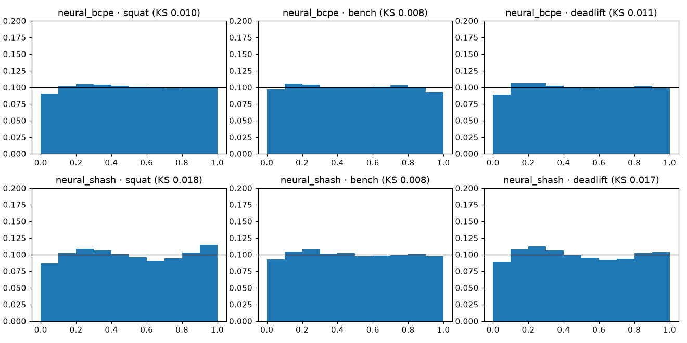
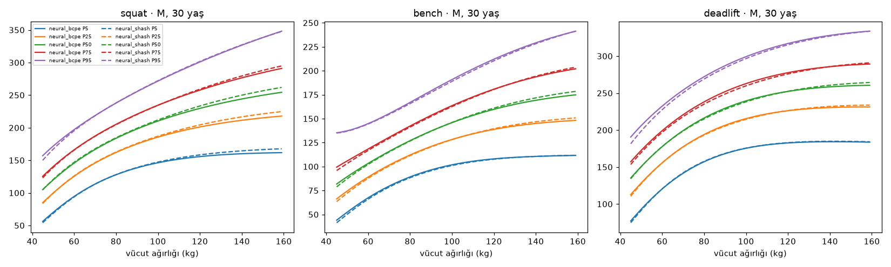
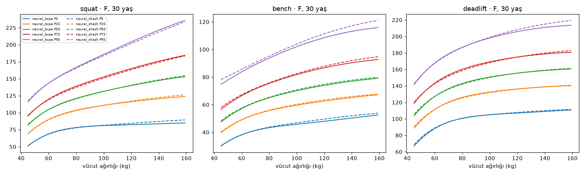
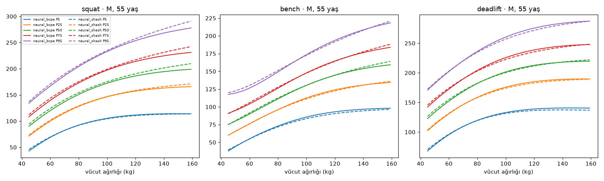

# Aday C — Sinirsel dağılımsal regresyon (P052)

Üretim: `make train-c` (`gymml/models/neural_run.py`, model `gymml/models/neural.py`). Koşum izi:
`runs/20261113T112303Z-candidate_c/` (git-ignored). Değerlendirme P049 ortak koşumuyla (`evaluate_factory`)
**doğrulama** kümesinde; test kümesi kullanılmadı. Bölme özeti `9a2c6ae6e0dee826` (temel çizgilerle aynı).

## Model

- Girdiler: erkek mi (0/1), `(yaş − 35) / 15`, `(ln kilo − ln 80) / 0.3`
  (merkez ln 80 = 4.3820).
- Gövde: MLP [64, 64], silu; üç kaldırış ortak gövde, kaldırış başına 4 çıkışlı başlık.
  Parametre sayısı: bcpe 5,391, shash 5,391 (hedef < 50 000; float32
  ile ≈ 21 KB).
- Başlıklar: **BCPE** (μ, σ, ν, τ; μ = exp, σ = softplus, ν ∈ (−3, 3), τ ∈ (1, 10)) ve **sinh-arcsinh**
  (log ölçekte μ, s, ε, δ). BCPE matematiği modülün kendisinde (scipy `gennorm`/`lognorm` ve sayısal
  integralle test edildi); P050'nin BCPE'si ile P053'te tekilleştirilebilir.
- Korelasyon başlığı: SBD tam kayıtlarında normal skorlar `Φ⁻¹(F(y|x))` için koşullu R(x); Cholesky
  parametreli (birim köşegen için satır normalize edilmiş alt üçgen), Gauss kopula olabilirliği; marjinaller
  donduruldıktan sonra gövde özellikleri üzerinde doğrusal başlık olarak eğitilir (IFM).
- Eğitim: ağırlıklı NLL (örnek ağırlıkları `weight`), her dönem yükler ±1.25 kg titreştirilir (2.5 kg
  yuvarlama), AdamW (lr 0.003, ağırlık azaltma 0.0001), kosinüs öğrenme hızı, batch
  8192, en çok 30 dönem, sabır 3. Erken durdurma train bölmesinden
  sporcu-gruplu ayrılan %10'luk iç kümeyle (val'e dokunulmaz).
- Cezalar: girdi-Jacobian (Hutchinson, λ = 0.001) — pürüzsüzlük; aynı yükte z-skoru kiloyla artarsa
  ReLU² cezası (λ = 1) — kiloda artmama testi için.
- Eğitim özeti: bcpe: 20 dönem, en iyi iç-ayrık NLL 4.6767; kopula 8 dönem; shash: 15 dönem, en iyi iç-ayrık NLL 4.6843; kopula 7 dönem.
- Tek satır çıkarım (Python, torch ileri geçiş + scipy CDF): bcpe 0.14 ms, shash 0.11 ms.
  Core ML/Swift'te çok daha hızlı olması beklenir; §4.3 dağıtım kısıtı P058'de ölçülecek.

### Girdi kırpma kuralı (Swift aynen uygular)

Model hiçbir zaman eğitim aralığının dışında değerlendirilmez: önce `clamp`, sonra standartlaştırma.
Sınırlar eğitim verisinin (üç kaldırış birleşik) desteği — dilim 0 – 1,
yani en küçük – en büyük gözlem — 0.5'e dışa yuvarlanmış; yaş tüm veri, kilo cinsiyete göre:

- yaş: 14 – 85
- kilo (M): 31 – 244.5 kg, kilo (F): 30 – 226 kg

Sınırlar `params_draft/correlation.json` → `input_clip` alanında; P058 `params.json`'a taşır. Sonuç: aralık
dışında skor, en yakın sınır noktasının skoruyla aynıdır (örn. 300 kg'lık kişi 244.5 kg gibi
değerlendirilir). Cinsiyeti belirtilmemiş kullanıcı için §4.5 karışımı üst katmanda yapılır.

İlk denemede sınırlar %0.1 – %99.9 dilimleriydi (yaş 14–79, kilo M 47–180, F 40–155). Kırpma noktasında
medyan eğrisinde eğim kırığı oluşur; bu noktalar olağan kullanıcı aralığının içinde kaldığı için pürüzsüzlük
testi (yaş 16–80, kilo 45–150) |Δ²medyan|/medyan ≈ 0.02–0.03 ile başarısız oldu — en büyük ikinci fark
tam olarak yaş 79 ve erkek kilo 47'deydi; kırık dışındaki değerler < 0.001. Bu yüzden kural destek sınırlarına
genişletildi: seyrek uçlarda model gövdenin pürüzsüz devamıdır (Jacobian cezası), dışarısı yine sabit.

## Metrikler (doğrulama kümesi) — temel çizgilerle birlikte

| model | lift | n_val | pinball_kg | crps_kg | pit_ks | katman | katman_max_pp | 2pp_üstü_katman | bant_dışı_katman | kalibrasyon_kapısı | akıl_sağlığı |
|---|---|---|---|---|---|---|---|---|---|---|---|
| cell_empirical | squat | 80,232 | 9.393 | 18.787 | 0.006 | 39 | 7.108 | 27 | 3 | ✅ | 2/5 |
| cell_empirical | bench | 105,766 | 6.186 | 12.371 | 0.005 | 55 | 10.948 | 34 | 7 | ❌ | 2/5 |
| cell_empirical | deadlift | 89,988 | 9.310 | 18.620 | 0.005 | 45 | 8.809 | 29 | 2 | ✅ | 2/5 |
| dots_empirical | squat | 80,232 | 10.073 | 20.147 | 0.005 | 39 | 38.170 | 39 | 33 | ❌ | 4/5 |
| dots_empirical | bench | 105,766 | 6.734 | 13.468 | 0.005 | 55 | 41.009 | 55 | 46 | ❌ | 4/5 |
| dots_empirical | deadlift | 89,988 | 10.036 | 20.072 | 0.007 | 45 | 37.812 | 45 | 37 | ❌ | 4/5 |
| neural_bcpe | squat | 80,232 | 9.136 | 18.272 | 0.010 | 39 | 5.962 | 33 | 5 | ❌ | 4/5 |
| neural_bcpe | bench | 105,766 | 6.041 | 12.082 | 0.008 | 55 | 8.115 | 45 | 10 | ❌ | 4/5 |
| neural_bcpe | deadlift | 89,988 | 9.067 | 18.134 | 0.011 | 45 | 6.890 | 34 | 7 | ❌ | 4/5 |
| neural_shash | squat | 80,232 | 9.158 | 18.317 | 0.018 | 39 | 8.788 | 33 | 14 | ❌ | 4/5 |
| neural_shash | bench | 105,766 | 6.047 | 12.093 | 0.008 | 55 | 9.966 | 44 | 7 | ❌ | 4/5 |
| neural_shash | deadlift | 89,988 | 9.077 | 18.155 | 0.017 | 45 | 12.249 | 39 | 11 | ❌ | 4/5 |

Birincil başlık (ortalama pinball'a göre): **bcpe**.

| model | lift | pinball_kg | en_iyi_temel | pinball_iyileşme_% |
|---|---|---|---|---|
| neural_bcpe | squat | 9.136 | 9.393 | 2.742 |
| neural_bcpe | bench | 6.041 | 6.186 | 2.339 |
| neural_bcpe | deadlift | 9.067 | 9.310 | 2.612 |
| neural_shash | squat | 9.158 | 9.393 | 2.502 |
| neural_shash | bench | 6.047 | 6.186 | 2.247 |
| neural_shash | deadlift | 9.077 | 9.310 | 2.499 |

## Akıl sağlığı testleri

Ayarlar `SanityConfig` (temel çizgilerle aynı; tepe yaşı aralığı 20–40, açık soru P049).

| model | lift | test | sonuç | ayrıntı |
|---|---|---|---|---|
| neural_bcpe | squat | skor yükte kesin artan (Q05–Q95 arası, 2.5 kg adım) | ✅ | en küçük CDF artışı 5.17e-03 |
| neural_bcpe | squat | aynı yükte skor kiloyla artmıyor | ✅ | kilo +1 kg'da en büyük CDF artışı 0.0006 (tolerans 0.005) |
| neural_bcpe | squat | yaş eğrisi tek tepeli, tepe 20–40, sıçrama yok | ❌ | tepe yaşı M/F [23.0, 23.0], en büyük yıllık değişim 0.056, tek tepeli=True |
| neural_bcpe | squat | pürüzsüzlük (ikinci fark sınırı) | ✅ | en büyük |Δ²medyan|/medyan 0.0086 (sınır 0.01) |
| neural_bcpe | squat | eğitim aralığı dışında makul davranış | ✅ | sonlu, pozitif, sıralı, fiziksel sınır içinde |
| neural_bcpe | bench | skor yükte kesin artan (Q05–Q95 arası, 2.5 kg adım) | ✅ | en küçük CDF artışı 7.39e-03 |
| neural_bcpe | bench | aynı yükte skor kiloyla artmıyor | ✅ | kilo +1 kg'da en büyük CDF artışı 0.0005 (tolerans 0.005) |
| neural_bcpe | bench | yaş eğrisi tek tepeli, tepe 20–40, sıçrama yok | ❌ | tepe yaşı M/F [35.0, 23.0], en büyük yıllık değişim 0.063, tek tepeli=True |
| neural_bcpe | bench | pürüzsüzlük (ikinci fark sınırı) | ✅ | en büyük |Δ²medyan|/medyan 0.0084 (sınır 0.01) |
| neural_bcpe | bench | eğitim aralığı dışında makul davranış | ✅ | sonlu, pozitif, sıralı, fiziksel sınır içinde |
| neural_bcpe | deadlift | skor yükte kesin artan (Q05–Q95 arası, 2.5 kg adım) | ✅ | en küçük CDF artışı 5.12e-03 |
| neural_bcpe | deadlift | aynı yükte skor kiloyla artmıyor | ✅ | kilo +1 kg'da en büyük CDF artışı 0.0014 (tolerans 0.005) |
| neural_bcpe | deadlift | yaş eğrisi tek tepeli, tepe 20–40, sıçrama yok | ❌ | tepe yaşı M/F [24.0, 24.0], en büyük yıllık değişim 0.054, tek tepeli=True |
| neural_bcpe | deadlift | pürüzsüzlük (ikinci fark sınırı) | ✅ | en büyük |Δ²medyan|/medyan 0.0080 (sınır 0.01) |
| neural_bcpe | deadlift | eğitim aralığı dışında makul davranış | ✅ | sonlu, pozitif, sıralı, fiziksel sınır içinde |
| neural_shash | squat | skor yükte kesin artan (Q05–Q95 arası, 2.5 kg adım) | ✅ | en küçük CDF artışı 5.09e-03 |
| neural_shash | squat | aynı yükte skor kiloyla artmıyor | ✅ | kilo +1 kg'da en büyük CDF artışı 0.0003 (tolerans 0.005) |
| neural_shash | squat | yaş eğrisi tek tepeli, tepe 20–40, sıçrama yok | ❌ | tepe yaşı M/F [24.0, 24.0], en büyük yıllık değişim 0.055, tek tepeli=True |
| neural_shash | squat | pürüzsüzlük (ikinci fark sınırı) | ✅ | en büyük |Δ²medyan|/medyan 0.0081 (sınır 0.01) |
| neural_shash | squat | eğitim aralığı dışında makul davranış | ✅ | sonlu, pozitif, sıralı, fiziksel sınır içinde |
| neural_shash | bench | skor yükte kesin artan (Q05–Q95 arası, 2.5 kg adım) | ✅ | en küçük CDF artışı 6.82e-03 |
| neural_shash | bench | aynı yükte skor kiloyla artmıyor | ✅ | kilo +1 kg'da en büyük CDF artışı 0.0005 (tolerans 0.005) |
| neural_shash | bench | yaş eğrisi tek tepeli, tepe 20–40, sıçrama yok | ❌ | tepe yaşı M/F [38.0, 24.0], en büyük yıllık değişim 0.060, tek tepeli=True |
| neural_shash | bench | pürüzsüzlük (ikinci fark sınırı) | ✅ | en büyük |Δ²medyan|/medyan 0.0079 (sınır 0.01) |
| neural_shash | bench | eğitim aralığı dışında makul davranış | ✅ | sonlu, pozitif, sıralı, fiziksel sınır içinde |
| neural_shash | deadlift | skor yükte kesin artan (Q05–Q95 arası, 2.5 kg adım) | ✅ | en küçük CDF artışı 5.69e-03 |
| neural_shash | deadlift | aynı yükte skor kiloyla artmıyor | ✅ | kilo +1 kg'da en büyük CDF artışı 0.0007 (tolerans 0.005) |
| neural_shash | deadlift | yaş eğrisi tek tepeli, tepe 20–40, sıçrama yok | ❌ | tepe yaşı M/F [24.0, 24.0], en büyük yıllık değişim 0.049, tek tepeli=True |
| neural_shash | deadlift | pürüzsüzlük (ikinci fark sınırı) | ✅ | en büyük |Δ²medyan|/medyan 0.0073 (sınır 0.01) |
| neural_shash | deadlift | eğitim aralığı dışında makul davranış | ✅ | sonlu, pozitif, sıralı, fiziksel sınır içinde |

### Yaş testi ve gençlerde hızlı artış

Yaş testinin "yıllık sıçrama ≤ %4" koşulu 16–80 yaş aralığının tamamına uygulanıyor.
Ham train verisinde (ağırlıklı medyan, tipik kilo bandı) 16–20 yaş arası yıllık değişim:

| kaldırış | cinsiyet | 16→17 | 17→18 | 18→19 | 19→20 |
|---|---|---|---|---|---|
| squat | M | 0.043 | 0.042 | 0.027 | 0.013 |
| squat | F | 0.079 | 0.024 | 0.024 | 0.023 |
| bench | M | 0.045 | 0.043 | 0.042 | 0.020 |
| bench | F | 0.100 | 0.031 | 0.058 | 0.000 |
| deadlift | M | 0.037 | 0.036 | 0.023 | 0.023 |
| deadlift | F | 0.043 | 0.042 | 0.040 | 0.000 |

Gençlerde yıllık artış verinin kendisinde %4'ün üzerinde olabildiğinden, veriye sadık bir model bu koşulu
16–17 yaşta ihlal edebilir. Kriter değiştirilmedi (§4.3); `docs/ILERLEME.md` Ertelenenler'e açık soru olarak yazıldı.

## Eğitim aralığı dışı davranış (bcpe)

Kırpma sayesinde çıktı sonlu, pozitif ve sıralı; `sınırla_aynı` sütunu çıktının kırpılmış girdiyle birebir
aynı olduğunu gösterir. Birim testi: `tests/test_neural.py::test_out_of_range_inputs_do_not_explode`
(yaş 1–150, kilo 5–1000 kg).

| cinsiyet | durum | yaş | kilo | kaldırış | Q05 | Q50 | Q95 | sınırla_aynı | sonlu_sıralı |
|---|---|---|---|---|---|---|---|---|---|
| M | çok genç | 10.0 | 90.0 | squat | 88.4 | 147.2 | 201.8 | True | True |
| M | çok genç | 10.0 | 90.0 | bench | 58.0 | 92.2 | 128.3 | True | True |
| M | çok genç | 10.0 | 90.0 | deadlift | 113.5 | 169.3 | 220.2 | True | True |
| M | çok yaşlı | 95.0 | 90.0 | squat | 40.6 | 81.1 | 129.0 | True | True |
| M | çok yaşlı | 95.0 | 90.0 | bench | 40.7 | 70.3 | 102.2 | True | True |
| M | çok yaşlı | 95.0 | 90.0 | deadlift | 64.9 | 115.3 | 166.2 | True | True |
| M | çok hafif | 30.0 | 25.0 | squat | 19.2 | 58.1 | 104.0 | True | True |
| M | çok hafif | 30.0 | 25.0 | bench | 22.3 | 56.1 | 137.1 | True | True |
| M | çok hafif | 30.0 | 25.0 | deadlift | 34.7 | 86.6 | 134.3 | True | True |
| M | çok ağır | 30.0 | 300.0 | squat | 157.9 | 273.4 | 418.1 | True | True |
| M | çok ağır | 30.0 | 300.0 | bench | 115.1 | 180.0 | 262.5 | True | True |
| M | çok ağır | 30.0 | 300.0 | deadlift | 178.0 | 252.4 | 331.6 | True | True |
| M | genç + ağır | 10.0 | 300.0 | squat | 92.7 | 196.0 | 330.3 | True | True |
| M | genç + ağır | 10.0 | 300.0 | bench | 66.5 | 110.3 | 176.6 | True | True |
| M | genç + ağır | 10.0 | 300.0 | deadlift | 120.6 | 180.2 | 245.4 | True | True |
| M | yaşlı + hafif | 95.0 | 25.0 | squat | 8.3 | 30.3 | 56.8 | True | True |
| M | yaşlı + hafif | 95.0 | 25.0 | bench | 13.2 | 36.0 | 66.7 | True | True |
| M | yaşlı + hafif | 95.0 | 25.0 | deadlift | 22.9 | 58.0 | 89.6 | True | True |
| F | çok genç | 10.0 | 65.0 | squat | 46.7 | 83.3 | 121.2 | True | True |
| F | çok genç | 10.0 | 65.0 | bench | 27.1 | 45.0 | 69.6 | True | True |
| F | çok genç | 10.0 | 65.0 | deadlift | 63.6 | 100.0 | 134.9 | True | True |
| F | çok yaşlı | 95.0 | 65.0 | squat | 17.3 | 38.3 | 66.7 | True | True |
| F | çok yaşlı | 95.0 | 65.0 | bench | 16.3 | 27.7 | 44.7 | True | True |
| F | çok yaşlı | 95.0 | 65.0 | deadlift | 36.8 | 63.7 | 92.2 | True | True |
| F | çok hafif | 30.0 | 25.0 | squat | 21.6 | 44.7 | 71.5 | True | True |
| F | çok hafif | 30.0 | 25.0 | bench | 17.3 | 32.3 | 67.4 | True | True |
| F | çok hafif | 30.0 | 25.0 | deadlift | 32.8 | 65.8 | 96.3 | True | True |
| F | çok ağır | 30.0 | 300.0 | squat | 86.2 | 162.1 | 270.1 | True | True |
| F | çok ağır | 30.0 | 300.0 | bench | 57.6 | 81.7 | 118.0 | True | True |
| F | çok ağır | 30.0 | 300.0 | deadlift | 113.9 | 159.7 | 210.8 | True | True |
| F | genç + ağır | 10.0 | 300.0 | squat | 55.1 | 123.0 | 214.6 | True | True |
| F | genç + ağır | 10.0 | 300.0 | bench | 36.5 | 54.1 | 83.8 | True | True |
| F | genç + ağır | 10.0 | 300.0 | deadlift | 80.4 | 117.4 | 157.1 | True | True |
| F | yaşlı + hafif | 95.0 | 25.0 | squat | 8.1 | 20.2 | 36.2 | True | True |
| F | yaşlı + hafif | 95.0 | 25.0 | bench | 10.6 | 18.6 | 32.0 | True | True |
| F | yaşlı + hafif | 95.0 | 25.0 | deadlift | 21.1 | 41.4 | 60.3 | True | True |

## Dış doğrulama: van den Hoek 2024

| model | sex | lift | age_group | n | vdh | model_oran | veri_ağırlıksız | fark_% | geçti |
|---|---|---|---|---|---|---|---|---|---|
| neural_bcpe | M | squat | 18-35 | 37,242 | 2.830 | 2.765 | 2.860 | -2.302 | True |
| neural_bcpe | F | squat | 18-35 | 16,605 | 2.260 | 2.177 | 2.300 | -3.688 | False |
| neural_bcpe | M | squat | >80 | 39 | 1.720 | 1.548 | 1.618 | -9.999 | None |
| neural_bcpe | F | squat | >80 | 9 | 1.010 | 1.081 | 1.190 | 6.989 | None |
| neural_bcpe | M | bench | 18-35 | 47,426 | 1.950 | 1.879 | 1.928 | -3.643 | False |
| neural_bcpe | F | bench | 18-35 | 19,481 | 1.350 | 1.235 | 1.335 | -8.513 | False |
| neural_bcpe | M | bench | >80 | 80 | 1.310 | 1.222 | 1.263 | -6.737 | None |
| neural_bcpe | F | bench | >80 | 13 | 0.920 | 0.707 | 0.755 | -23.109 | None |
| neural_bcpe | M | deadlift | 18-35 | 41,227 | 3.250 | 3.164 | 3.259 | -2.646 | True |
| neural_bcpe | F | deadlift | 18-35 | 18,158 | 2.660 | 2.547 | 2.672 | -4.253 | False |
| neural_bcpe | M | deadlift | >80 | 60 | 2.300 | 2.090 | 2.253 | -9.140 | None |
| neural_bcpe | F | deadlift | >80 | 15 | 1.680 | 1.564 | 1.605 | -6.924 | None |
| neural_shash | M | squat | 18-35 | 37,242 | 2.830 | 2.740 | 2.860 | -3.176 | False |
| neural_shash | F | squat | 18-35 | 16,605 | 2.260 | 2.135 | 2.300 | -5.534 | False |
| neural_shash | M | squat | >80 | 39 | 1.720 | 1.489 | 1.618 | -13.450 | None |
| neural_shash | F | squat | >80 | 9 | 1.010 | 1.066 | 1.190 | 5.559 | None |
| neural_shash | M | bench | 18-35 | 47,426 | 1.950 | 1.865 | 1.928 | -4.372 | False |
| neural_shash | F | bench | 18-35 | 19,481 | 1.350 | 1.239 | 1.335 | -8.223 | False |
| neural_shash | M | bench | >80 | 80 | 1.310 | 1.180 | 1.263 | -9.955 | None |
| neural_shash | F | bench | >80 | 13 | 0.920 | 0.748 | 0.755 | -18.672 | None |
| neural_shash | M | deadlift | 18-35 | 41,227 | 3.250 | 3.155 | 3.259 | -2.926 | True |
| neural_shash | F | deadlift | 18-35 | 18,158 | 2.660 | 2.547 | 2.672 | -4.252 | False |
| neural_shash | M | deadlift | >80 | 60 | 2.300 | 2.013 | 2.253 | -12.478 | None |
| neural_shash | F | deadlift | >80 | 15 | 1.680 | 1.579 | 1.605 | -5.985 | None |

## Yüzdelik eğrileri (A/B ile aynı grafik seti)

## Kaldırışlar arası korelasyon (§4.4)

Nüfus ortalaması R (train SBD satırları üzerinde ağırlıklı R(x) ortalaması; `params_draft/correlation.json`
→ `matrix`):

| | squat | bench | deadlift |
|---|---|---|---|
| squat | 1.000 | 0.724 | 0.817 |
| bench | 0.724 | 1.000 | 0.669 |
| deadlift | 0.817 | 0.669 | 1.000 |

Karşılaştırma — doğrulama SBD satırlarında normal skorların ağırlıklı ampirik Pearson korelasyonu:

| | squat | bench | deadlift |
|---|---|---|---|
| squat | 1.000 | 0.713 | 0.808 |
| bench | 0.713 | 1.000 | 0.661 |
| deadlift | 0.808 | 0.661 | 1.000 |

Doğrulama SBD kopula NLL (satır başına, 0 = bağımsızlık): bcpe -0.9060, shash -0.9063.

Koşullu R(x) ızgarası (bcpe):

| cinsiyet | yaş | kilo | S-B | S-D | B-D |
|---|---|---|---|---|---|
| M | 20.000 | 70.000 | 0.711 | 0.813 | 0.636 |
| M | 20.000 | 90.000 | 0.719 | 0.816 | 0.658 |
| M | 20.000 | 120.000 | 0.734 | 0.810 | 0.685 |
| M | 30.000 | 70.000 | 0.720 | 0.815 | 0.651 |
| M | 30.000 | 90.000 | 0.726 | 0.816 | 0.670 |
| M | 30.000 | 120.000 | 0.732 | 0.809 | 0.689 |
| M | 45.000 | 70.000 | 0.664 | 0.829 | 0.580 |
| M | 45.000 | 90.000 | 0.659 | 0.824 | 0.592 |
| M | 45.000 | 120.000 | 0.656 | 0.818 | 0.605 |
| M | 60.000 | 70.000 | 0.563 | 0.831 | 0.477 |
| M | 60.000 | 90.000 | 0.549 | 0.826 | 0.491 |
| M | 60.000 | 120.000 | 0.545 | 0.824 | 0.507 |
| F | 20.000 | 55.000 | 0.753 | 0.816 | 0.700 |
| F | 20.000 | 65.000 | 0.755 | 0.823 | 0.712 |
| F | 20.000 | 90.000 | 0.763 | 0.828 | 0.726 |
| F | 30.000 | 55.000 | 0.759 | 0.816 | 0.716 |
| F | 30.000 | 65.000 | 0.763 | 0.823 | 0.728 |
| F | 30.000 | 90.000 | 0.770 | 0.829 | 0.740 |
| F | 45.000 | 55.000 | 0.730 | 0.817 | 0.684 |
| F | 45.000 | 65.000 | 0.732 | 0.821 | 0.693 |
| F | 45.000 | 90.000 | 0.732 | 0.825 | 0.694 |
| F | 60.000 | 55.000 | 0.693 | 0.820 | 0.645 |
| F | 60.000 | 65.000 | 0.691 | 0.819 | 0.657 |
| F | 60.000 | 90.000 | 0.686 | 0.825 | 0.655 |

Izgarada çift korelasyonları 0.477 – 0.831; beklenen 0.4–0.9 aralığında ve pozitif tanımlı:
**evet**. P048 EDA artık korelasyonları (~0.70–0.84) ile uyumlu.

## Yorum

- Pinball'da birincil başlık en iyi temel çizgiyi 3/3 kaldırışta geçiyor (squat, bench, deadlift); iyileşme squat +2.7%, bench +2.3%, deadlift +2.6%.
- Akıl sağlığı: başarısız olanlar — neural_bcpe/bench: yaş eğrisi tek tepeli, tepe 20–40, sıçrama yok; neural_bcpe/deadlift: yaş eğrisi tek tepeli, tepe 20–40, sıçrama yok; neural_bcpe/squat: yaş eğrisi tek tepeli, tepe 20–40, sıçrama yok; neural_shash/bench: yaş eğrisi tek tepeli, tepe 20–40, sıçrama yok; neural_shash/deadlift: yaş eğrisi tek tepeli, tepe 20–40, sıçrama yok; neural_shash/squat: yaş eğrisi tek tepeli, tepe 20–40, sıçrama yok.
- Kalibrasyon kapısı (§4.3, onaylı yorum: katman sapması ≤ max(2 puan, gürültü bandı), bandı aşan katman ≤ %10): neural_bcpe/squat ❌ (bant dışı 5/39 = %13), neural_bcpe/bench ❌ (bant dışı 10/55 = %18), neural_bcpe/deadlift ❌ (bant dışı 7/45 = %16), neural_shash/squat ❌ (bant dışı 14/39 = %36), neural_shash/bench ❌ (bant dışı 7/55 = %13), neural_shash/deadlift ❌ (bant dışı 11/45 = %24).
- Hiperparametreler (genişlik/derinlik/aktivasyon/ağırlık azaltma/öğrenme hızı/başlık) P053'te Optuna ile
  aranacak; bu rapor tek bir makul varsayılan yapılandırmayı gösterir.
