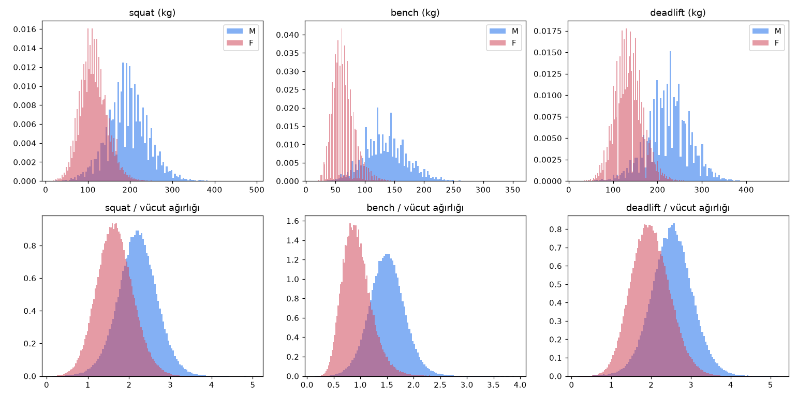
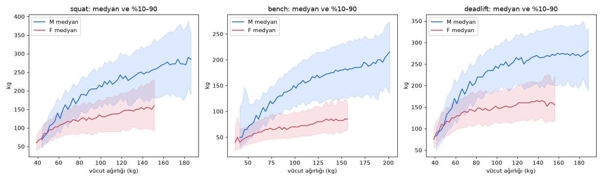
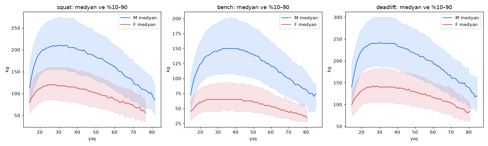
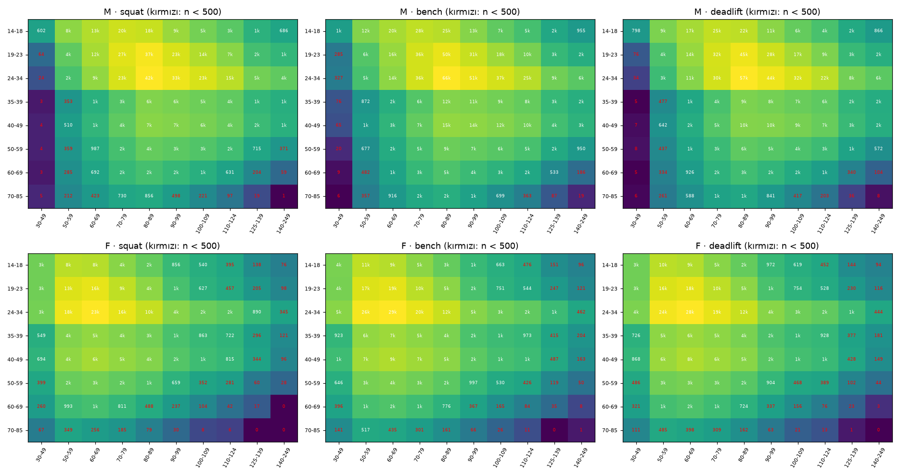

# Keşif analizi (P048)

Üretim: `make eda` (`gymml/data/cohort.py` + `gymml/data/eda.py`). Kaynak: OpenPowerlifting
(`data/interim/opl.parquet`, bkz. `data/SOURCES.md`). Bu rapor ve grafikler komutla yeniden üretilir.

## Kohort tanımı

- Cinsiyet M/F; ekipman `Raw` ve `Wraps` (Wraps kategorisi yalnızca dizlik sargısıdır: squat satırlarında
  `wraps = true` bayrağı, bench/deadlift satırlarında Raw sayılır). Model hedefi `wraps = false` satırlardır.
- Sıra `DQ`, `DD` (doping), `G` (misafir), `NS` (gelmedi) olan kayıtlar çıkarıldı.
- Yaş 14–85, vücut ağırlığı 30–250 kg, başarılı kaldırış > 0.
- Aykırı değer: kaldırış < 15 kg, mutlak üst sınır {'squat': 520.0, 'bench': 380.0, 'deadlift': 480.0} kg (ham dünya rekorlarının
  biraz üstü) veya vücut ağırlığı katı {'squat': 5.0, 'bench': 4.0, 'deadlift': 5.5} üzerindeyse atılır.
- Sporcu × takvim yılı × kaldırış (× wraps) başına en iyi kayıt; o kaydın yaş ve kilosu kullanılır.
- Ağırlık (`weight`): sporcunun o kaldırıştaki yıl kayıtlarının toplam ağırlığı 1 (ters-frekans).
- `tested` sütunu korunur; varsayılan referans `tested = true`, tüm veri duyarlılık analizi (P053).
- Katmanlar (P049): yaş bantları ['14-18', '19-23', '24-34', '35-39', '40-49', '50-59', '60-69', '70-85'], kilo bantları ['30-49', '50-59', '60-69', '70-79', '80-89', '90-99', '100-109', '110-124', '125-139', '140-249'].

## Süzgeç akışı

| adım | satır |
|---|---|
| girdi (opl.parquet) | 4,063,068 |
| sex ∈ {M,F} | 4,062,868 |
| equipment ∈ {Raw,Wraps} | 2,189,809 |
| diskalifiye/doping/misafir/gelmedi hariç | 2,093,525 |
| yaş biliniyor | 1,791,507 |
| yaş 14–85 | 1,767,904 |
| vücut ağırlığı 30–250 kg | 1,765,783 |
| uzun biçim, başarılı kaldırış > 0 | 4,123,342 |
| aykırı değer (mutlak sınır, kilo katı) hariç | 4,123,272 |
| sporcu × yıl × kaldırış en iyisi | 2,653,331 |

Kaldırış başına kohort (`cohort_long.parquet`):

| lift | wraps | sex | satır | sporcu | medyan_kg |
|---|---|---|---|---|---|
| bench | False | F | 279,090 | 138,802 | 62.5 |
| bench | False | M | 721,750 | 346,413 | 132.5 |
| deadlift | False | F | 259,104 | 131,592 | 135.0 |
| deadlift | False | M | 596,172 | 294,274 | 225.0 |
| squat | False | F | 209,747 | 109,231 | 112.5 |
| squat | False | M | 451,678 | 235,362 | 193.0 |
| squat | True | F | 35,264 | 21,861 | 117.5 |
| squat | True | M | 100,526 | 58,482 | 215.0 |

SBD ortak tablosu (`cohort_sbd.parquet`): 788,254 sporcu-yıl. Bench/squat oranı
(0.3, 1.5) veya deadlift/squat oranı (0.6, 2.2) dışında kalan
5,761 kayıt veri giriş hatası şüphesiyle bu tablodan çıkarıldı.

## Yaşı eksik kayıtlar: AgeClass orta noktası

Yaşı bilinen ve sınıfı da olan kayıtlarda orta noktanın hatası: ortalama 1.58 yıl,
%90'lık 4.0 yıl. Orta nokta kullanılırsa kohort 2,653,331 → 2,756,144
satır olur (106,155 satırın yaşı tahmini).

Aynı cinsiyet × kaldırış × yaş bandında, yaşı tahmini satırların medyanının gerçek yaşlı satırlara göre farkı
(yalnızca n ≥ 500 olan hücreler; ortalama |fark| %4.7):

| lift | ortalama_fark_% | en_büyük_|fark|_% |
|---|---|---|
| bench | -3.7 | 9.3 |
| deadlift | -4.6 | 10.4 |
| squat | -5.5 | 13.5 |

**Karar:** varsayılan `impute_age_from_class = False`. Gerekçe: (1) yaş, modelin üç girdisinden biri ve orta nokta
yaşı bantlar içinde sabitler, eğri biçimini (§4.3 akıl sağlığı testi: 20'lerin ortasında tepe) yapay
basamaklarla bozar; (2) yaşı eksik kayıtlar rastgele değil, belirli federasyonlardan gelir — medyan farkı
tablosu bu kitlenin farklı olduğunu gösteriyor; (3) kalan veri (2,653,331 satır) zaten bol. Seyrek yaşlı
bantlarda (70+) veri eksikse P053'te `impute_age_from_class = True` duyarlılık koşumu olarak denenebilir.

## Dağılımlar

Kaldırışlar sağa çarpık; kadın ve erkek dağılımları belirgin ayrık. Vücut ağırlığına oranlanınca çarpıklık
azalıyor, bu da log-kilo girdisini destekliyor.

## Vücut ağırlığı ve yaşa göre medyan eğrileri

Medyan kiloyla artıyor ama azalan hızla (ağır sıklette düzleşme). Uçlarda (çok hafif, 140 kg üstü, 70+ yaş)
bant genişliği ve gürültü artıyor.

Medyanın tepe yaptığı yaş (1 yıllık kutular; tepe değerin %1 yakınındaki yaş aralığı):

| lift | sex | tepe_kg | tepe_yaş_aralığı |
|---|---|---|---|
| squat | M | 210.0 | 27–34 |
| squat | F | 120.0 | 24–28 |
| bench | M | 150.0 | 32–41 |
| bench | F | 65.0 | 23–43 |
| deadlift | M | 242.5 | 30–30 |
| deadlift | F | 142.5 | 26–28 |

**Not (P049/P053 için):** ham veride tepe 20'lerin ortasında değil, daha geç ve geniş bir platoda (özellikle
bench'te 30'lar). §4.3'teki "beklenen medyan yaşta 20'lerin ortasında tepe yapmalı" akıl sağlığı testi bu
veriyle birebir uygulanırsa iyi bir model de kalabilir; testin "tepe ~20–40 arası, tek tepeli, ani sıçrama yok"
biçiminde yorumlanması kullanıcı onayına sunulmalı (kriter değişikliği P053 öncesi karara bağlanmalı).

Dağılım grafiğindeki tarak görüntüsü kayıtların 2.5 kg (ve lb dönüşümlü) adımlarla yuvarlanmasından gelir:
değerlendirmede (PIT, P049) bağlar için rastgele titreştirme gerekir.

## Tested ve tümü

| sex | lift | tümü_medyan | n_tümü | tested_medyan | n_tested | oran_tümü | oran_tested | oran_farkı_pct |
|---|---|---|---|---|---|---|---|---|
| F | bench | 62.500 | 279,090 | 62.500 | 209,610 | 0.913 | 0.918 | 0.548 |
| F | deadlift | 135.000 | 259,104 | 135.000 | 191,483 | 1.968 | 1.976 | 0.411 |
| F | squat | 112.500 | 209,747 | 112.500 | 172,326 | 1.646 | 1.659 | 0.751 |
| M | bench | 132.500 | 721,750 | 130.000 | 496,341 | 1.498 | 1.484 | -0.953 |
| M | deadlift | 225.000 | 596,172 | 220.000 | 410,571 | 2.525 | 2.533 | 0.333 |
| M | squat | 193.000 | 451,678 | 192.500 | 363,502 | 2.203 | 2.209 | 0.286 |

`oran_farkı_pct`: testli kayıtların kaldırış/kilo oranı medyanının tüm veriye göre farkı (yüzde).

## Örneklem büyüklüğü: cinsiyet × yaş bandı × kilo bandı

n < 500 olan hücreler (P049 kalibrasyon tablosuna girmez; model bu bölgelerde ekstrapolasyon yapar):

| lift | sex | dolu_hücre | seyrek_hücre |
|---|---|---|---|
| deadlift | F | 79 | 30 |
| deadlift | M | 80 | 17 |
| squat | F | 77 | 30 |
| bench | M | 80 | 13 |
| bench | F | 79 | 27 |
| squat | M | 80 | 20 |

Seyrek bölgeler (ısı haritasında kırmızı): erkeklerde 50 kg altı (her yaşta); kadınlarda 125 kg üstü (her yaşta)
ve 14–23 yaşta 110 kg üstü; iki cinsiyette 50+ yaşın uç kiloları ve 70+ yaşın çoğu hücresi. Bu bölgeler P049 akıl sağlığı testlerinde ("eğitim aralığı dışında makul
davranış") ve P052 girdi kırpma kuralında hedeflenmeli.

## SBD kaldırışları arası korelasyon (ön bakış)

Log-kaldırıştan log-kilo ve yaş² etkisi doğrusal olarak çıkarıldıktan sonra artıkların korelasyonu (raw):

| sex | n | S–B | S–D | B–D |
|---|---|---|---|---|
| M | 446,715 | 0.748 | 0.838 | 0.700 |
| F | 207,922 | 0.777 | 0.841 | 0.747 |

§4.4 ortak başlığı (P052) bu büyüklükleri yakalamalı.
